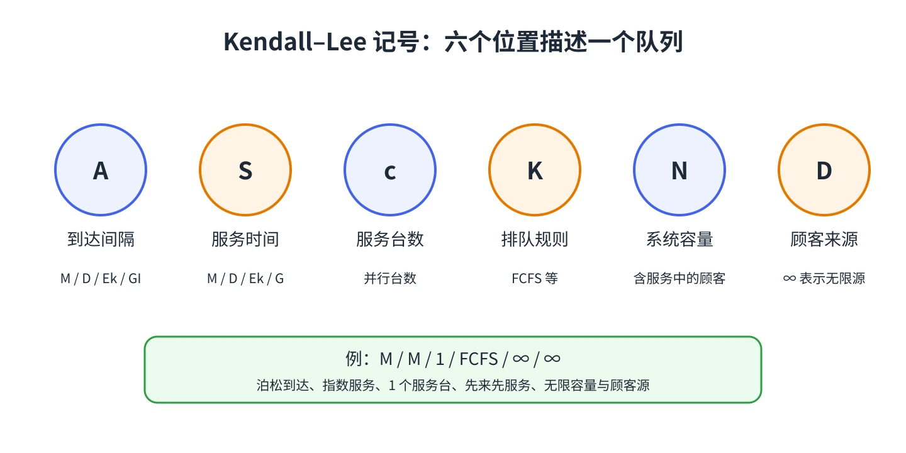

# 第 1 章 排队系统的基本术语

排队论研究的是等待线背后的数量关系。一个银行窗口、医院分诊台或文件服务器，都可以拆成同一条链：顾客到达、等待、接受服务，然后离开。

## 描述一个队列需要哪些信息？

- **顾客与来源**：谁会提出服务请求？顾客来源是有限的一组机器，还是可视为无限大的人群？
- **到达过程**：顾客何时到来、到达间隔如何变化，到达率是否会受系统拥挤程度影响？
- **服务过程**：每个服务台需要多久处理一个顾客，服务时间是否随机？
- **服务台数量**：一个窗口还是多个并行窗口？多台服务是否共用一个等待区？
- **系统容量**：系统最多容纳多少顾客。容量通常包括正在服务和排队等待的顾客。
- **排队规则**：先来先服务（FCFS）、后到先服务（LCFS）、随机选取（SIRO）或优先级服务。

顾客可能在到达前看到队列太长而离开，这称为 **balking（拒绝进入）**。也可能进入后中途离开，或在多个服务台之间选择一条队伍。教材后续模型会明确指出哪些行为被纳入，哪些被忽略。

## 评价队列的量

- $L_q$：排队等待的平均人数；$L_s$：正在接受服务的平均人数。
- $L=L_q+L_s$：系统内的平均人数。
- $W_q$：平均排队时间；$W_s$：平均服务时间；$W=W_q+W_s$：顾客在系统内的平均时间。
- **利用率**：服务台有顾客在服务的时间比例。利用率很高不一定代表系统好；接近满负荷时，随机波动会让等待时间变得很长。

## Kendall–Lee 记号

排队模型常写成 $A/S/c/K/N/D$。六个位置依次表示到达间隔分布、服务时间分布、服务台数、系统容量、顾客来源规模和服务规则。

常见字母包括：$M$ 表示指数分布（到达侧等价于泊松过程），$D$ 表示确定性时间，$E_k$ 表示 $k$ 阶 Erlang 分布，$GI$ 表示一般独立同分布的到达间隔，$G$ 表示一般分布。$\infty$ 表示无限容量或无限顾客源。

例如 $M/M/1/FCFS/\infty/\infty$ 表示泊松到达、指数服务、单个服务台、先来先服务，容量和顾客来源都视为无限。常用简写会省略默认的 FCFS 与两个无限量；使用简写时，要把省略的默认假设补回脑中。

::: tip 先问三个问题
顾客怎样来？服务怎样发生？满了以后会怎样？这三问通常就能排除一大批不合适的模型。
:::

&#8203;**教材对应**&#8203;：原书编号 20.1。
