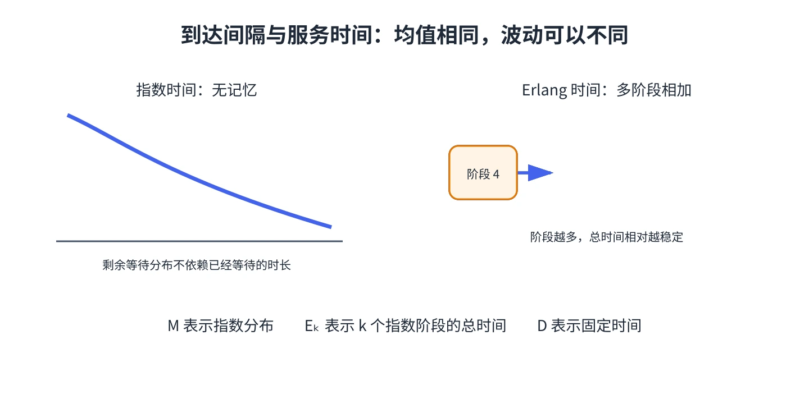

# 第 2 章 到达过程与服务过程

随机性是排队的关键。即使平均服务能力高于平均到达率，顾客也可能扎堆到达、服务时间也可能偶尔特别长。模型必须描述这种波动，而不能只比较两个平均数。

## 到达率与泊松过程

记相邻两次到达之间的时间为 $A$。如果 $A$ 服从参数为 $\lambda$ 的指数分布，则

$$
f_A(t)=\lambda e^{-\lambda t},\qquad t\ge 0,\qquad E[A]=\frac1\lambda.
$$

此时，长度为 $t$ 的时间段内到达人数 $N(t)$ 服从参数为 $\lambda t$ 的泊松分布：

$$
P\{N(t)=n\}=e^{-\lambda t}\frac{(\lambda t)^n}{n!},\qquad E[N(t)]=\operatorname{Var}(N(t))=\lambda t.
$$

这里的 $\lambda$ 是单位时间的平均到达人数，不是“每个顾客的到达时间”。例如平均每小时 30 人到达，则 $\lambda=30$ 人/小时，平均到达间隔是 $1/30$ 小时。

指数分布有**无记忆性**：已经等了多久，不会改变接下来还要等多久的分布。它并不表示“每时每刻到达机会都一样大”，而是说剩余等待时间不依赖已等待时间。相反，如果把观察者随机放到公交站，他更容易落在一个较长的到达间隔中；不能把“平均间隔的一半”误当作随机到站者的平均剩余等待时间。

## Erlang 分布和确定性时间

如果一个过程由 $k$ 个独立的指数阶段串联组成，总时间服从 Erlang 分布。若希望总平均时间为 $1/\lambda$，各阶段的速率设为 $k\lambda$：

$$
f(t)=\frac{(k\lambda)^k t^{k-1}e^{-k\lambda t}}{(k-1)!},\qquad E[T]=\frac1\lambda.
$$

$k=1$ 时 Erlang 就是指数分布；$k$ 增大时，阶段总时间的相对波动减小。若每次间隔都完全相同，则称为确定性（$D$）时间。

服务过程用同样方式描述。记平均服务率为 $\mu$，平均服务时间为 $1/\mu$。不同顾客的服务时间通常假定相互独立；指数服务有助于建立马尔可夫模型，Erlang 或一般分布则可描述不同程度的波动。

## 选分布时别只看均值

两个服务过程可以有相同平均服务时间，却有完全不同的波动。波动较大时，同样的平均负荷可能产生更长等待。后续的 M/G/1 与 G/G/m 模型会把服务时间方差也纳入计算。

&#8203;**教材对应**&#8203;：原书编号 20.2；教材还用随机到站和泊松到达例题说明指数分布的无记忆性。
