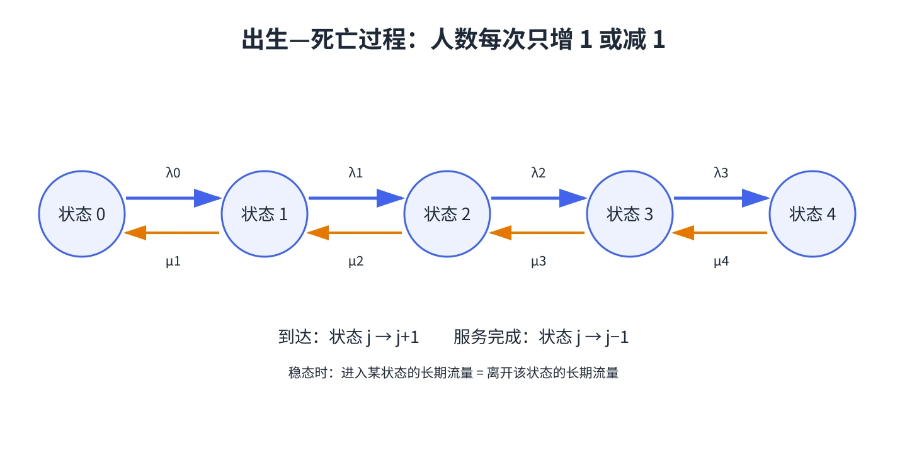

# 第 3 章 出生—死亡过程

把“系统里有几位顾客”作为状态，就能把很多队列转成一条状态链。到达使人数增加 1，服务完成使人数减少 1；教材把这种连续时间随机过程称为**出生—死亡过程**。

## 状态变化规律

当系统处于状态 $j$ 时，令 $\lambda_j$ 为到达（出生）速率，$\mu_j$ 为服务完成（死亡）速率。在很短的时间 $\Delta t$ 内，

$$
P(j\to j+1)=\lambda_j\Delta t+o(\Delta t),\qquad
P(j\to j-1)=\mu_j\Delta t+o(\Delta t).
$$

状态不能为负，因此 $\mu_0=0$。对 M/M/1 队列，$\lambda_j=\lambda$，而 $j\ge1$ 时 $\mu_j=\mu$。对多服务台队列，当有 $j$ 位顾客时，忙碌服务台数为 $\min(j,s)$，所以 $\mu_j=\min(j,s)\mu$。

## 稳态流量平衡

若长期稳态存在，记 $\pi_j$ 为系统恰有 $j$ 位顾客的概率。流量平衡方程可写成相邻状态之间的平衡：

$$
\pi_j\lambda_j=\pi_{j+1}\mu_{j+1},\qquad j\ge0.
$$

于是

$$
\pi_j=\pi_0\prod_{i=0}^{j-1}\frac{\lambda_i}{\mu_{i+1}},\qquad
\pi_0=\left(1+\sum_{j=1}^{\infty}\prod_{i=0}^{j-1}\frac{\lambda_i}{\mu_{i+1}}\right)^{-1}.
$$

有限容量时求和只到最大状态；无限容量时，归一化级数必须收敛。若到达长期快于系统最大服务能力，概率无法归一化，也就没有稳态分布。**“有公式”不等于“系统稳定”**：先检查稳态条件，再代入概率公式。

## 为什么是“流量平衡”，不是人数相等？

流量平衡比较的是单位时间内跨越状态边界的概率流率。稳态下，每个状态进入与离开的长期速率相等；否则概率质量会不断堆到某些状态。将得到的 $\pi_j$ 归一化后，可以计算平均系统人数：

$$
L=\sum_{j\ge0}j\pi_j.
$$

&#8203;**教材对应**&#8203;：原书编号 20.3，含稳态方程的流量平衡解释以及用递推/表格计算状态概率的例题。
