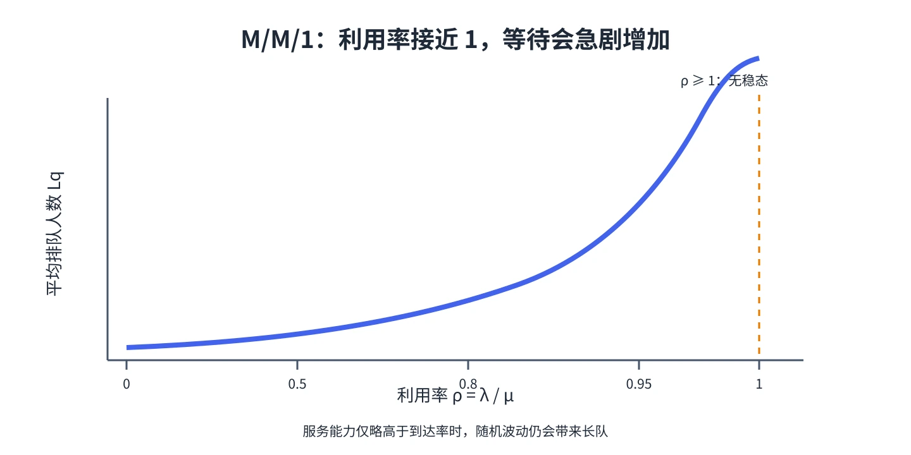

# 第 4 章 M/M/1 与 Little 定律

M/M/1 是最基础的稳态队列：顾客按泊松过程到达，服务时间独立且服从指数分布，只有一个服务台，系统容量和顾客源都无限。先确认这个模型描述的是你要研究的系统，再用它的闭式公式。

## 稳态条件与状态概率

令到达率为 $\lambda$，服务率为 $\mu$，利用率为

$$
\rho=\frac{\lambda}{\mu}.
$$

只有 $\rho<1$ 时，单个服务台的长期服务能力才超过到达负荷，稳态才存在。此时

$$
\pi_j=(1-\rho)\rho^j,\qquad j=0,1,2,\ldots
$$

系统越接近满负荷，长队出现的概率越高；当 $\rho\to1$ 时，平均队长和等待时间急剧上升。

## 平均人数与等待时间

$$
L=\frac{\rho}{1-\rho}=\frac{\lambda}{\mu-\lambda},\qquad
L_q=\frac{\rho^2}{1-\rho}=\frac{\lambda^2}{\mu(\mu-\lambda)},
$$

$$
W=\frac1{\mu-\lambda},\qquad
W_q=\frac{\lambda}{\mu(\mu-\lambda)}.
$$

系统中平均有 $\rho$ 位顾客正在服务，所以 $L_s=\rho$，且 $L=L_q+L_s$。$W$ 包含服务时间，$W_q$ 不包含服务时间，二者不要混用。

## Little 定律：连接人数和时间

在稳定且流量定义一致的系统中，Little 定律为

$$
L=\lambda W,\qquad L_q=\lambda W_q.
$$

它的直觉是“系统里平均人数 = 平均进入速度 × 平均停留时间”。Little 定律不要求到达或服务服从指数分布，但稳定性和顾客流量口径要一致。有限容量且会有顾客被拒绝时，应使用**实际进入系统的有效到达率**。

## 教材例题：每小时 10 人到达、服务率每小时 15 人

利用率 $\rho=10/15=2/3$。于是 $L=2$ 人、$L_q=4/3$ 人，$W=1/(15-10)=0.2$ 小时（12 分钟），$W_q=8$ 分钟。结果也符合 Little 定律：$10\times0.2=2$。

&#8203;**教材对应**&#8203;：原书编号 20.4；本章由 M/M/1 推出 Little 定律及队列、服务中的人数和时间公式。
