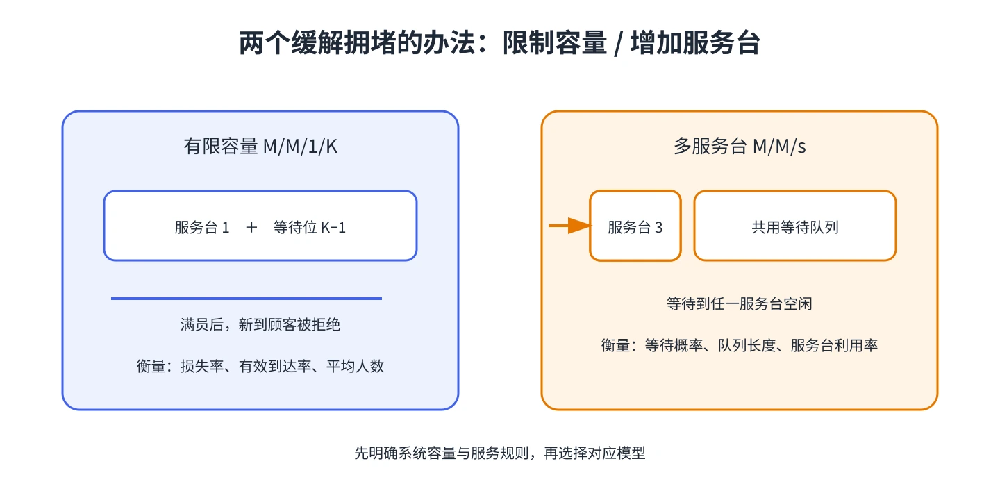

# 第 5 章 有限容量的 M/M/1/K

当候诊室、缓存或停车区有明确上限时，无限容量 M/M/1 会高估系统能接纳的顾客数。M/M/1/K 的状态只能是 $0,1,\ldots,K$；$K$ 包括正在服务的顾客。

## 满员时发生什么？

假设外部到达仍为速率 $\lambda$ 的泊松过程，服务率为 $\mu$。状态达到 $K$ 时，新到顾客无法进入并离开系统（损失/阻塞）。令 $\rho=\lambda/\mu$，则当 $\rho\ne1$：

$$
\pi_0=\frac{1-\rho}{1-\rho^{K+1}},\qquad
\pi_j=\pi_0\rho^j,\quad 0\le j\le K.
$$

若 $\rho=1$，各状态概率相同，$\pi_j=1/(K+1)$。有限容量下即使 $\lambda\ge\mu$，状态空间仍有限，稳态概率依然存在；代价体现在较高的拒绝概率。

## 计算有效流量与等待

到达时系统已满的概率是 $\pi_K$，所以顾客接纳率为 $1-\pi_K$，有效到达率为

$$
\lambda_{\mathrm{eff}}=\lambda(1-\pi_K).
$$

平均系统人数为 $L=\sum_{j=0}^{K}j\pi_j$；服务中平均人数 $L_s=1-\pi_0$，故 $L_q=L-L_s$。对已进入系统的顾客，使用 Little 定律得到 $W=L/\lambda_{\mathrm{eff}}$ 和 $W_q=L_q/\lambda_{\mathrm{eff}}$。

当 $\rho\ne1$，也可直接使用

$$
L=\frac{\rho\left(1-(K+1)\rho^K+K\rho^{K+1}\right)}{(1-\rho)(1-\rho^{K+1})}.
$$

有限容量模型回答的是“多少人会被拒绝、被接纳者等多久”。不能把外部到达率 $\lambda$ 直接代入 Little 定律来算已接纳顾客的停留时间。

&#8203;**教材对应**&#8203;：原书编号 20.5；教材还比较了 $\lambda=\mu$ 与 $\lambda\ne\mu$ 的稳态结果。
