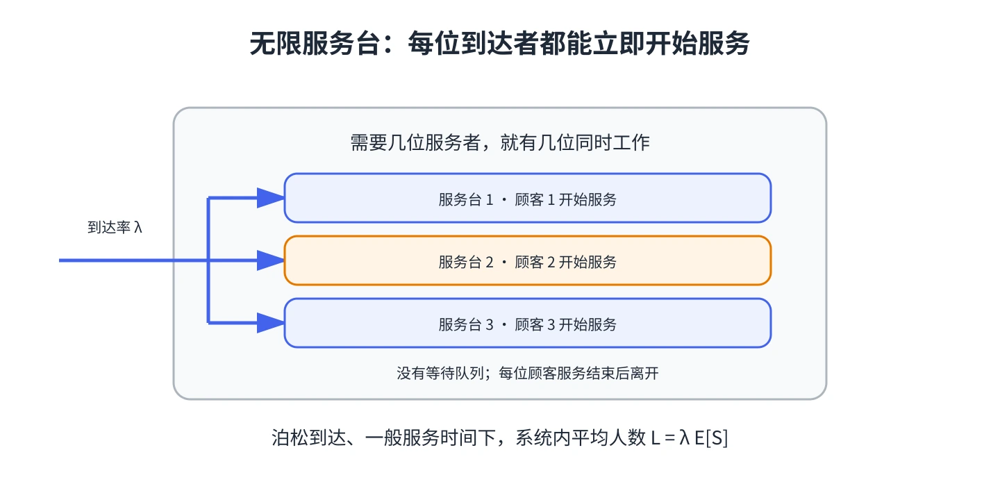

# 第 7 章 无限服务台模型：M/G/∞ 与 GI/G/∞

想象每位到达者都能立刻获得一个服务台，不需要等待。这是无限服务台模型的理想化假设，常用于分析“等待不受服务台数量限制”的系统或建立基准。

## M/G/∞：泊松到达，一般服务时间

$M/G/\infty$ 假设到达是泊松过程，服务时间可服从任意分布且平均值有限，每个顾客立即获得独立服务。系统人数的稳态分布为泊松分布，其均值是

$$
L=\lambda E[S].
$$

由于没有等待队列，$L_q=0$、$W_q=0$；进入系统的顾客平均停留时间就是平均服务时间 $W=E[S]$。服务时间分布的形状会改变在任意时刻的状态细节，但稳态平均人数只取决于到达率和平均服务时间。

## GI/G/∞：一般到达间隔与一般服务时间

$GI/G/\infty$ 放宽到达间隔分布，不再要求到达是泊松过程；服务时间也只要求独立同分布且平均值有限。利用 Little 定律，长期平均系统人数仍为

$$
L=\lambda E[S].
$$

要注意：这个平均数关系并不表示人数必然服从泊松分布，也不意味着该模型适合有等待、限容量或服务台数量有限的情况。

## 适用边界

真实服务台总是有限的。若计算结果暗示同一时刻常有大量顾客在服务，应把有限服务能力、顾客流失或排队规则加入模型，再用相应的有限服务台模型分析。

&#8203;**教材对应**&#8203;：原书编号 20.7，讨论无限服务台的 M/G/∞ 与 GI/G/∞ 模型。
