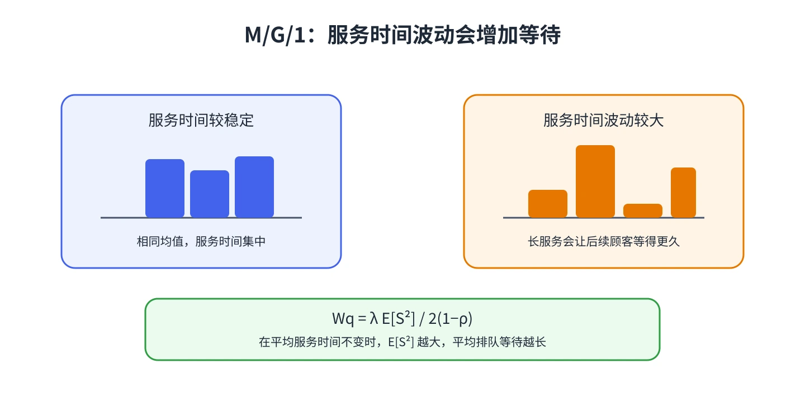

# 第 8 章 一般服务时间的 M/G/1

单服务台队列的服务时间未必是指数分布。M/G/1 保留泊松到达和单服务台，但允许服务时间服从一般分布。它揭示了一个重要结论：等待不只由平均服务时间决定，还受服务时间波动影响。

## Pollaczek–Khinchin 关系

记服务时间为 $S$，$b=E[S]=1/\mu$，到达率为 $\lambda$，利用率为 $\rho=\lambda b<1$。先求二阶矩

$$
E[S^2]=\operatorname{Var}(S)+(E[S])^2.
$$

平均排队等待时间为

$$
W_q=\frac{\lambda E[S^2]}{2(1-\rho)},\qquad
L_q=\lambda W_q=\frac{\lambda^2 E[S^2]}{2(1-\rho)}.
$$

进而 $W=W_q+b$，$L=L_q+\rho$。若将服务时间写成变异系数平方 $C_s^2=\operatorname{Var}(S)/b^2$，则

$$
W_q=\frac{\rho b(1+C_s^2)}{2(1-\rho)}.
$$

## 这条公式说明什么？

当平均服务时间不变，$C_s^2$ 越大，平均等待越长。若服务时间是指数分布，$C_s^2=1$，公式退化为 M/M/1 的等待公式；若服务时间较稳定，等待通常会更短。

## 计算顺序

1. 统一时间单位，求 $\lambda$ 与 $b=E[S]$。
2. 检查 $\rho=\lambda b<1$。
3. 用样本或已知分布求 $E[S^2]$，不能只用均值代替。
4. 算出 $W_q$、$L_q$，再加上服务时间得到 $W$、$L$。

公式基于泊松到达、独立同分布服务时间和 FCFS 单服务台。若优先级、有限容量、服务中断或时间变化显著，应改用匹配假设的模型。

&#8203;**教材对应**&#8203;：原书编号 20.8，使用一般服务时间的二阶矩分析单服务台等待。
