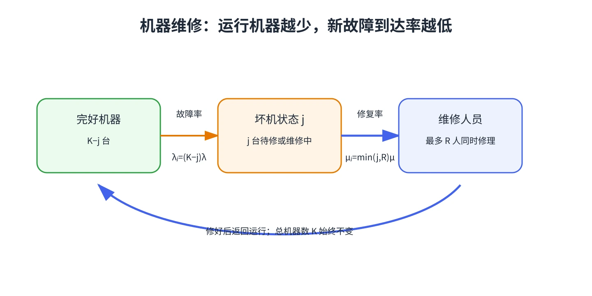

# 第 9 章 有限来源：机器维修模型

有限来源模型里，顾客总数本身有上限，而且系统状态会影响后续到达率。机器维修是典型例子：机器坏得越多，仍在运行、可能再坏的机器就越少。

## 把坏掉的机器数作为状态

设系统共有 $K$ 台机器、$R$ 名维修人员，状态 $j$ 表示坏掉的机器数。每台完好机器以速率 $\lambda$ 故障，因此

$$
\lambda_j=(K-j)\lambda.
$$

若每名维修人员以速率 $\mu$ 修好一台机器，则总维修完成率为

$$
\mu_j=\min(j,R)\mu.
$$

这说明故障率会随状态下降，而不是始终等于 $K\lambda$。修理员忙不过来时，等待维修的机器形成队列。

## 稳态概率

利用出生—死亡递推式，令 $\pi_0$ 由 $\sum_{j=0}^{K}\pi_j=1$ 确定，则

$$
\pi_j=\begin{cases}
\pi_0\dfrac{K!}{(K-j)!}\left(\dfrac{\lambda}{\mu}\right)^j,&0\le j\le R,\\[8pt]
\pi_0\dfrac{K!}{(K-j)!R!R^{j-R}}\left(\dfrac{\lambda}{\mu}\right)^j,&R<j\le K.
\end{cases}
$$

平均坏机数 $L=\sum_j j\pi_j$，平均等候维修的坏机数 $L_q=\sum_{j=R+1}^{K}(j-R)\pi_j$。平均故障进入率不是常数 $K\lambda$，而是

$$
\lambda_{\mathrm{eff}}=\sum_{j=0}^{K}(K-j)\lambda\pi_j=\lambda(K-L).
$$

因此平均停机时间 $W=L/\lambda_{\mathrm{eff}}$，维修队列中的平均等待时间 $W_q=L_q/\lambda_{\mathrm{eff}}$。

## 怎么看结果？

增加维修人员会缩短故障机器等待，但当只有少数机器损坏时，过多维修人员会闲置。由于有限来源让到达率随状态变化，本模型和“固定外部到达率”的 M/M/s 不同。

&#8203;**教材对应**&#8203;：原书编号 20.9，含 5 台巡逻车、维修人员数量和车辆故障率的机器维修例题。
