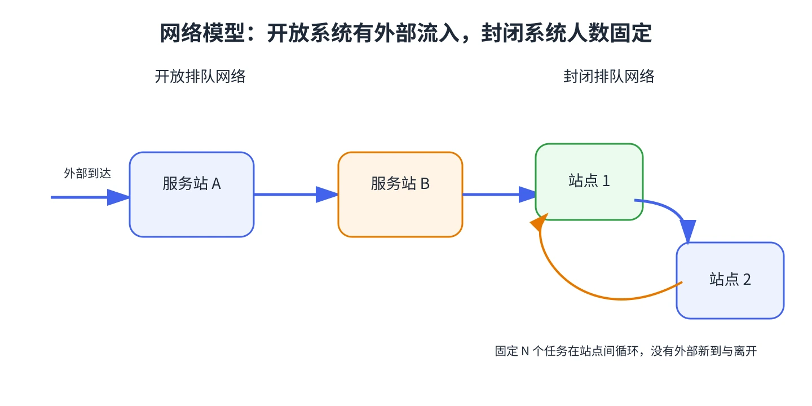

# 第 10 章 串联队列与开放排队网络

许多工作不是在一个窗口完成，而要依次经过多个站点：汽车安装发动机后再装轮胎，数据包经过多个网络节点。每个站点都有自己的队列，但顾客的路线把这些队列连成网络。

## 串联系统

若顾客按固定顺序经过各站点，且站点之间没有分流或回流，可依次分析每一站。在泊松到达、指数服务和稳态条件下，前一站的离开流在相应模型条件下仍可作为后一站的泊松到达流。每一站都必须有足够的服务能力；若任一站不稳定，整个流程的等待会在该处积累。

若顾客必须完成全部 $k$ 个站点才离开，平均总停留时间等于各站平均停留时间之和。总系统平均人数可将各站的平均人数相加。

## 开放 Jackson 网络

开放网络允许外部到达，也允许完成路线后离开。设站点 $j$ 的外部到达率为 $r_j$，顾客离开站点 $i$ 后去站点 $j$ 的概率为 $p_{ij}$，则有效到达率满足流量方程

$$
\lambda_j=r_j+\sum_i\lambda_i p_{ij}.
$$

对 M/M/1 站点，必须有 $\lambda_j<\mu_j$；对 $s_j$ 个并行服务台，必须有 $\lambda_j<s_j\mu_j$。在 Jackson 网络条件成立时，每站可使用相应 M/M/1 或 M/M/s 稳态结果分析，开放网络中各站的稳态人数分布具有乘积分解性质。

## 解题顺序

1. 画出站点和路线，写明外部到达率与路由概率。
2. 解流量方程，得到每个站点实际面对的 $\lambda_j$。
3. 逐站检查稳定条件并计算队列指标。
4. 若要求全程平均时间，将各站等待与服务时间相加；再用 Little 定律检查总体人数。

不要把某站的外部到达率直接当成总到达率。经过上游路由后，站点流量可能增加或分流。

&#8203;**教材对应**&#8203;：原书编号 20.10，包括串联服务、开放网络流量方程，以及制造和通信网络例题。
