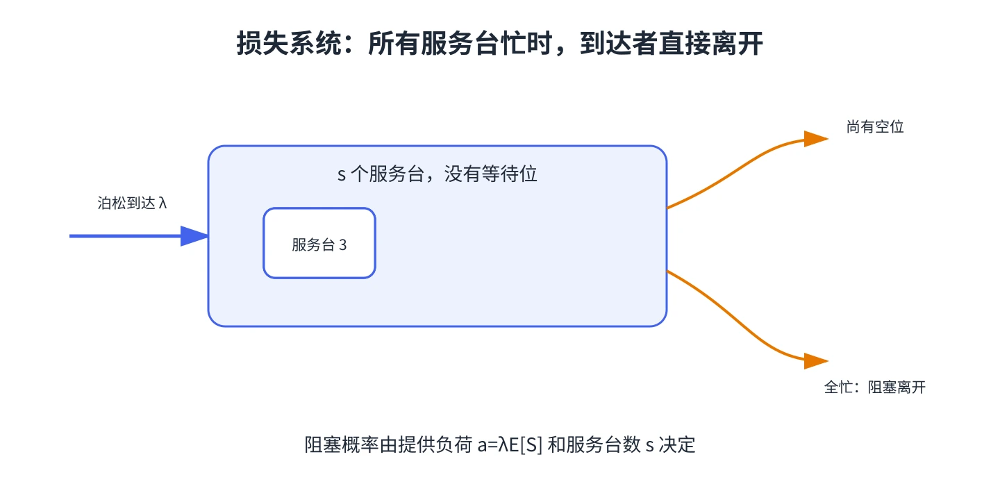

# 第 11 章 阻塞后离开的损失系统

有些系统没有等待空间：顾客到达时若所有服务台都忙，就离开并转向别处。电话忙线、呼叫资源不足或没有空闲救护车，都可能用“阻塞后离开”（blocked customers cleared，BCC）模型描述。

## M/G/s/s 损失模型

泊松到达率为 $\lambda$，有 $s$ 个服务台，服务时间可服从一般分布，且没有等待位。令平均服务时间为 $E[S]$，提供负荷为

$$
a=\lambda E[S].
$$

全部服务台忙时到达的概率（阻塞概率）是 Erlang 损失公式：

$$
B(s,a)=\frac{a^s/s!}{\displaystyle\sum_{n=0}^{s}a^n/n!}.
$$

在该模型条件下，阻塞概率只依赖到达率、平均服务时间和服务台数量；服务时间具体分布形状不影响这一稳态损失比例。接纳率为 $1-B(s,a)$，有效到达率为 $\lambda_{\mathrm{eff}}=\lambda[1-B(s,a)]$，平均忙碌服务台数为 $a[1-B(s,a)]$。

## 服务台配置

如果目标是“最多 1% 的到达被阻塞”，逐个增加 $s$，计算 $B(s,a)$，直到首次达到目标。再把设备或人员成本与被拒绝请求造成的损失比较。服务台数量增多会降低阻塞，但常有边际收益递减。

这与本教程第 5 章不同：M/M/1/K 有服务台和等待空间；这里系统容量恰好等于服务台数量，没人排队。

&#8203;**教材对应**&#8203;：原书编号 20.11，教材用救护车和电话资源说明阻塞后离开的系统，并用损失概率表分析服务台数。
