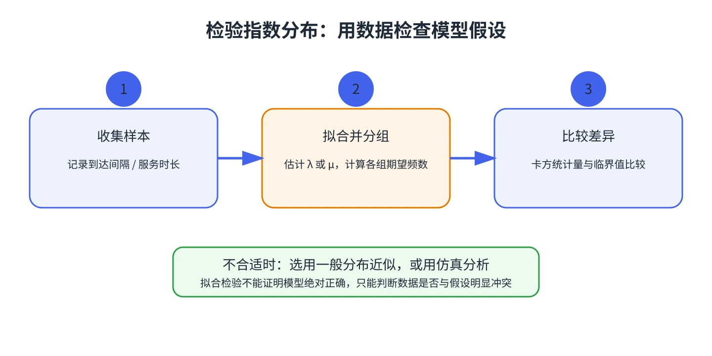

# 第 12 章 检验到达和服务时间是否服从指数分布

M/M/1、M/M/s 等公式建立在指数到达间隔或指数服务时间假设上。收集实际间隔与服务时长后，不能因为均值看起来合理，就断定指数分布适用。

## 用卡方拟合优度检验

以到达间隔样本 $t_1,\ldots,t_n$ 为例，估计平均间隔 $\bar t$，令 $\hat\lambda=1/\bar t$。按拟合指数分布把可能的时间范围划分为 $k$ 个类别，计算每类实际观测数 $o_i$ 和模型预期数 $e_i$，再计算

$$
\chi^2=\sum_{i=1}^{k}\frac{(o_i-e_i)^2}{e_i}.
$$

可让各类别在模型下具有相同概率，使期望频数较均衡。若估计了 $r$ 个模型参数，自由度通常为 $k-1-r$；本章估计一个指数率参数时 $r=1$。在显著性水平 $\alpha$ 下，将统计量与卡方临界值比较：统计量较大时，数据与该假设有明显冲突；未拒绝假设并不证明分布一定正确。

## 检查流程与注意点

1. 分别收集相邻到达间隔和服务时长；不要把两种样本混在一起。
2. 估计相应的 $\lambda$ 或 $\mu$，并说明所选时间单位。
3. 选择类别，计算实际与预期频数，确保预期频数足以支撑近似检验。
4. 解释检验结论，并检查数据是否独立、稳定，是否存在高峰时段或不同顾客类型。

教材也指出可以使用 Kolmogorov–Smirnov 检验。若指数假设不合适，可用 Allen–Cunneen 近似；没有可靠公式时，可以通过仿真评估。

&#8203;**教材对应**&#8203;：原书编号 20.12，含旅行社电话时长的卡方拟合例题。
