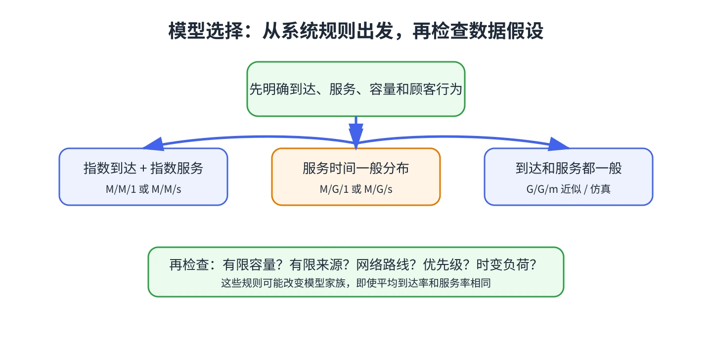

# 第 14 章 G/G/m 的 Allen–Cunneen 近似

如果到达间隔和服务时间都不是指数分布，M/M/m 的精确公式通常不能直接套用。G/G/m 用一般分布描述两者；教材介绍 Allen–Cunneen 近似来估计等待与队长。

## 用变异系数修正 M/M/m

令到达间隔的平方变异系数为

$$
C_a^2=\frac{\operatorname{Var}(A)}{(E[A])^2},
$$

服务时间的平方变异系数为 $C_s^2=\operatorname{Var}(S)/(E[S])^2$。指数分布的平方变异系数为 1。对稳定的 $m$ 服务台系统，先按同样的平均到达率和服务率计算 M/M/m 的 $L_q^{M/M/m}$ 与 $W_q^{M/M/m}$，再近似为

$$
L_q\approx\frac{C_a^2+C_s^2}{2}L_q^{M/M/m},\qquad
W_q\approx\frac{C_a^2+C_s^2}{2}W_q^{M/M/m}.
$$

之后用 $L=\lambda W$、$W=W_q+E[S]$ 得到系统层面的平均量。该近似在两类时间均为指数分布时系数为 1，与 M/M/m 结果一致。

## 如何使用近似

1. 从样本估计均值与方差，计算 $C_a^2$ 和 $C_s^2$。
2. 检查总利用率 $\rho=\lambda/(m\mu)<1$。
3. 先计算 M/M/m 等待，再按波动程度修正。
4. 把结果当作近似值，并做敏感性分析；对重要决策用仿真或数据验证。

如果观测值强烈随时段变化，单一稳态 G/G/m 仍可能不够，应考虑本教程第 16 章的瞬态模型。

&#8203;**教材对应**&#8203;：原书编号 20.14，使用到达与服务时间的平方变异系数作为近似输入。
