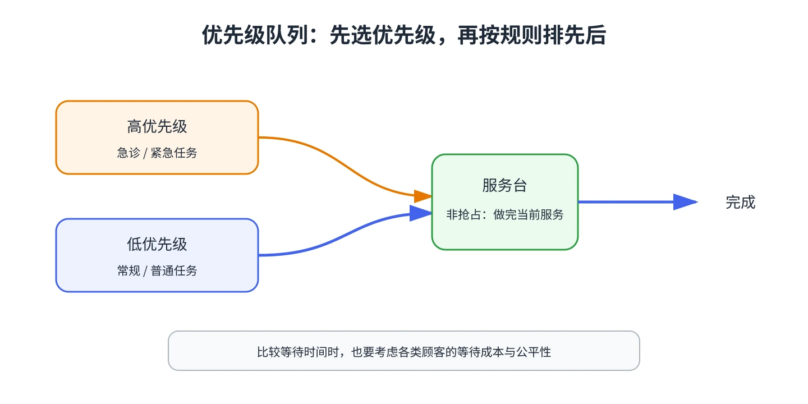

# 第 15 章 优先级排队模型

急诊呼叫、紧急计算任务和常规请求的等待代价不同，常用优先级规则决定谁先获得服务。优先级会改变各类顾客的等待分布，因此模型需要区分顾客类型。

## 非抢占优先级

教材首先讨论非抢占优先级（NPRP）：低优先级顾客一旦开始服务，不会被打断；服务完成后，服务台从等待者中选择优先级最高的一类。同一类别内再按 FCFS 排序。

对单服务台 M/G/1 非抢占模型，按优先级从高到低编号。令 $\rho_i=\lambda_iE[S_i]$，$a_0=0$，$a_k=\sum_{i=1}^{k}\rho_i$。系统稳定要求 $\sum_i\rho_i<1$。第 $k$ 类的平均排队等待时间为

$$
W_{qk}=\frac{\displaystyle\sum_{i=1}^{n}\lambda_iE[S_i^2]/2}{(1-a_{k-1})(1-a_k)}.
$$

再加上该类平均服务时间得到系统逗留时间 $W_k=W_{qk}+E[S_k]$。优先级越低，前面累积的高优先级负荷越大，等待通常越长。多服务台非抢占模型也可分析，但要按各类到达率及服务台总负荷一起计算。

## 选择优先级的经济解释

如果第 $k$ 类顾客每单位逗留时间带来成本 $c_k$，单服务台的成本最小化原则是优先服务 $c_kE[S_k]$ 较大的类别。各类单位时间成本相同，便得到**最短处理时间优先**：平均服务时间较短的作业先做，可降低系统总平均人数。

这不等于所有场景都应让短任务优先。急诊的生命风险、合同承诺或公平性可能比平均人数更重要，应先明确优化目标。

## 抢占优先级

抢占模型允许高优先级到达者中断低优先级服务。被中断者可从中断处继续（抢占恢复），也可重新开始（抢占重复）。指数服务具有无记忆性时，两种处理在该模型中的剩余服务时间等价。教材给出了单服务台指数服务的抢占模型，并用教师与学生计算作业作例子。

&#8203;**教材对应**&#8203;：原书编号 20.15，含非抢占多类别模型、成本排序、短作业优先和抢占模型。
