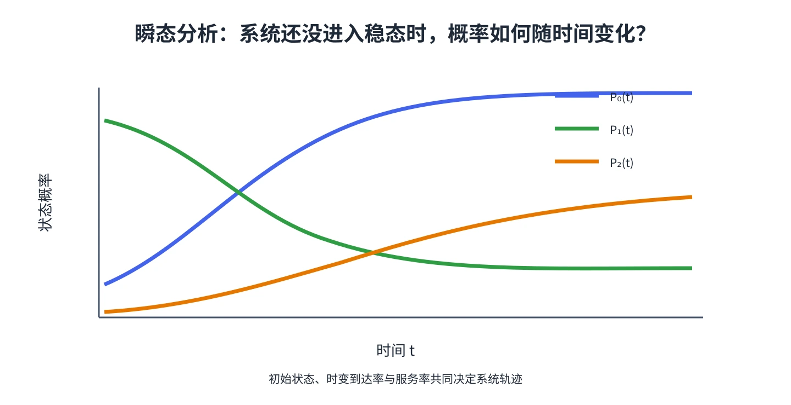

# 第 16 章 排队系统的瞬态行为

稳态分析描述系统运行很久后的平均表现。餐厅午餐高峰、医院交班或有固定营业时段的服务系统，关心的往往是某个具体时间点，而不是无限久以后的平均值。这就需要**瞬态分析**。

## 状态概率随时间演化

记 $P_i(t)$ 为时间 $t$ 系统中恰有 $i$ 位顾客的概率。教材用一个小时间步 $\Delta t$ 做递推：在这段时间内，以 $\lambda(t)\Delta t$ 近似一次到达概率，以 $\min(i,s(t))\mu(t)\Delta t$ 近似服务完成概率，并忽略同一小段里连续发生两次变化的高阶小概率。

对 $1\le i<N$ 的有限容量系统，

$$
\begin{aligned}
P_i(t+\Delta t)\approx{}&\lambda(t)\Delta t\,P_{i-1}(t)\\
&+[1-\lambda(t)\Delta t-\min(i,s(t))\mu(t)\Delta t]P_i(t)\\
&+\min(i+1,s(t))\mu(t)\Delta t\,P_{i+1}(t).
\end{aligned}
$$

三项分别来自“从少一人状态到达”“状态不变”“从多一人状态完成服务”。空系统与满容量边界需单独处理：人数不能小于 0，满员时的到达会被拒绝。

## 计算步骤

1. 指定初始状态分布；若系统开始为空，则 $P_0(0)=1$。
2. 设定时间步长和随时间变化的到达率、服务率或服务台数量。
3. 按递推式逐步更新各人数状态的概率。
4. 用 $E[N(t)]=\sum_i iP_i(t)$ 得到任意时刻的平均人数，或合并状态概率回答问题。

步长过大时，近似误差会增加；步长缩小会提高计算量。应检查每个时刻概率和接近 1，并比较不同步长下关键结果是否稳定。

## 教材例题：餐厅午间客流

教材将餐厅到达率设为随时间变化的泊松过程，服务率为每小时 50 人，并按 5 秒步长递推状态概率。计算得到中午 12:30 平均约有 6.25 人在排队或服务中，11:30 约有 1.43 人。两时刻虽然属于同一系统，客流阶段不同，人数分布也不同。

&#8203;**教材对应**&#8203;：原书编号 20.16，含时变到达率餐厅例题及有限容量系统的状态概率递推。
