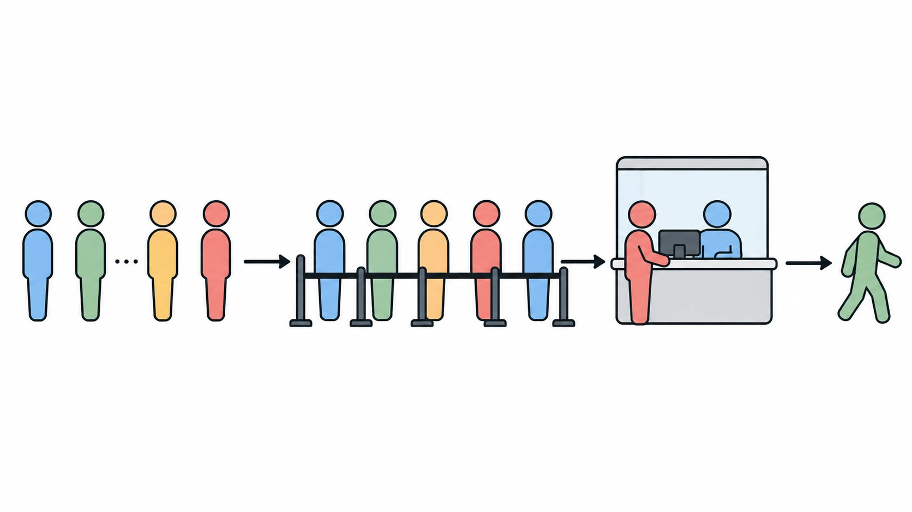
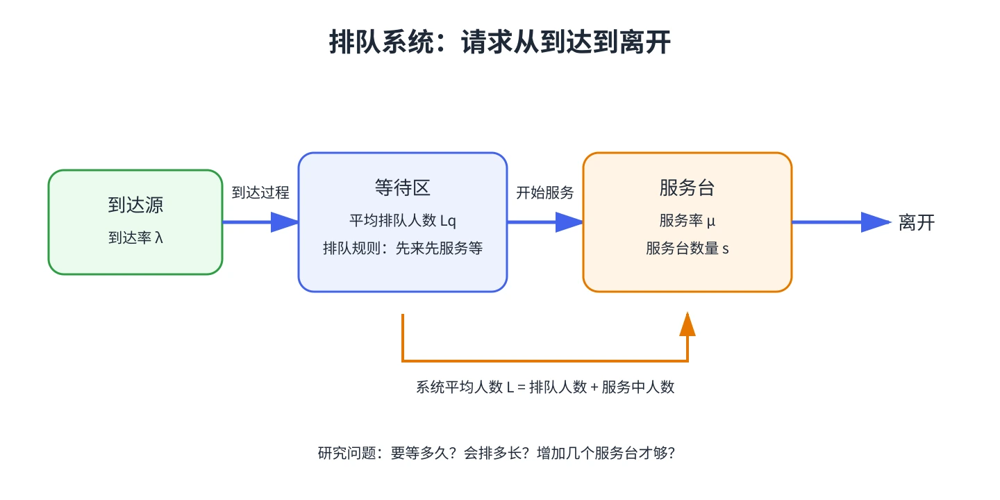

# 排队论

本课程依据 Wayne L. Winston 的 *Operations Research: Applications and Algorithms* 编写，按原书 20.1—20.16 的顺序，将每部分作为一章。每章先解释场景和假设，再说明符号、公式与例题，帮助读者把计算结果和真实排队现象对应起来。

::: tip 学习目标
学完后，你应能把现实服务过程转成排队模型，判断模型何时有稳态，计算等待时间、队长和服务台利用率，并知道指数假设不合适时该如何处理。
:::

## 学习路线

1. **先看懂系统**：排队术语、到达过程和服务过程（第 1—2 章）
2. **建立通用工具**：出生—死亡过程与稳态概率（第 3 章）
3. **从单队列到网络**：M/M/1、有限容量、多服务台、一般服务时间、有限来源和网络（第 4—11 章）
4. **处理现实偏差**：检验指数假设、封闭网络、近似方法、优先级与瞬态变化（第 12—16 章）

## 课程章节

- [第 1 章 排队系统的基本术语](./chapter-01-排队系统的基本术语)
- [第 2 章 到达过程与服务过程](./chapter-02-到达过程与服务过程)
- [第 3 章 出生—死亡过程](./chapter-03-出生死亡过程)
- [第 4 章 M/M/1 与 Little 定律](./chapter-04-mm1与Little定律)
- [第 5 章 有限容量的 M/M/1/K](./chapter-05-有限容量的mm1k)
- [第 6 章 多服务台 M/M/s](./chapter-06-多服务台mms)
- [第 7 章 无限服务台模型 M/G/∞ 与 GI/G/∞](./chapter-07-无限服务台模型)
- [第 8 章 一般服务时间的 M/G/1](./chapter-08-一般服务时间的mg1)
- [第 9 章 有限来源：机器维修模型](./chapter-09-有限来源与机器维修模型)
- [第 10 章 串联队列与开放排队网络](./chapter-10-开放排队网络)
- [第 11 章 阻塞后离开的损失系统](./chapter-11-阻塞后离开的损失系统)
- [第 12 章 检验到达和服务时间是否服从指数分布](./chapter-12-检验指数分布假设)
- [第 13 章 封闭排队网络](./chapter-13-封闭排队网络)
- [第 14 章 G/G/m 的 Allen–Cunneen 近似](./chapter-14-ggm近似)
- [第 15 章 优先级排队模型](./chapter-15-优先级排队模型)
- [第 16 章 排队系统的瞬态行为](./chapter-16-瞬态行为)
- [章节复习与模型选择](./章节复习与模型选择)

## 课程使用的记号

| 记号 | 含义 |
| --- | --- |
| $\lambda$ | 平均到达率（单位时间内到达的顾客数） |
| $\mu$ | 单个服务台的平均服务率 |
| $s$ | 并行服务台数量 |
| $L,L_q$ | 系统内、排队中的平均顾客数 |
| $W,W_q$ | 顾客在系统内、排队中的平均时间 |
| $\rho$ | 服务能力使用程度；多服务台时为 $\lambda/(s\mu)$ |

请始终核对时间单位。例如到达率若按“每小时”计，服务时间也必须换算成小时。

## 教材来源

教材：Wayne L. Winston, *Operations Research: Applications and Algorithms*，其中的 “Queuing Theory” 内容（用户提供的 `Queuing Theory-20240403115531-pq930vo.pdf`，印刷页码 1051—1144）。课程用自己的语言解释概念，并重画示意图；公式与模型条件以该教材为准。
