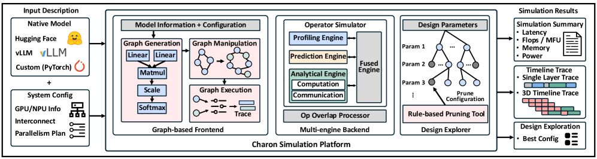
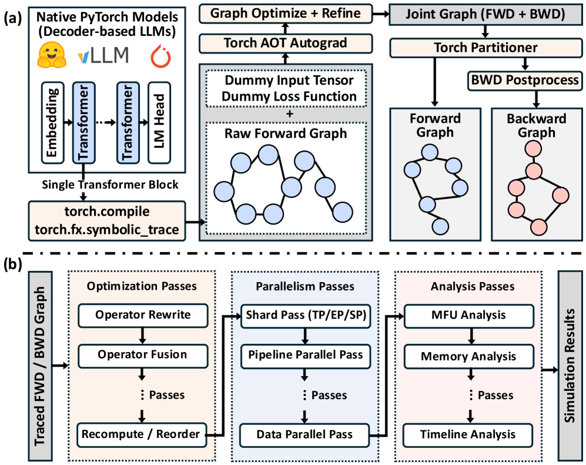
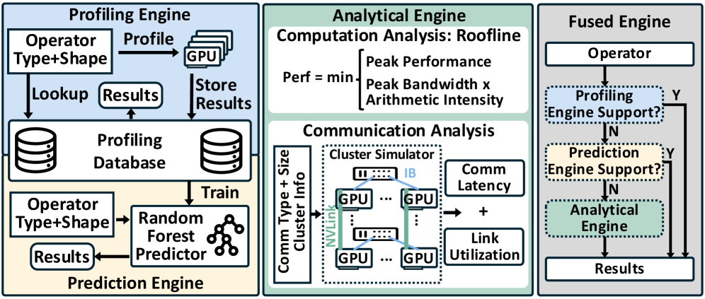
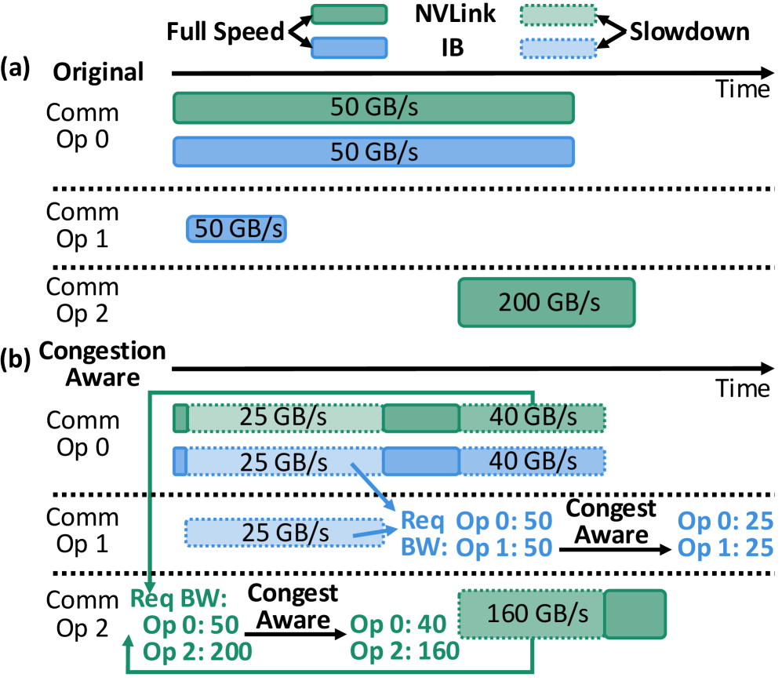
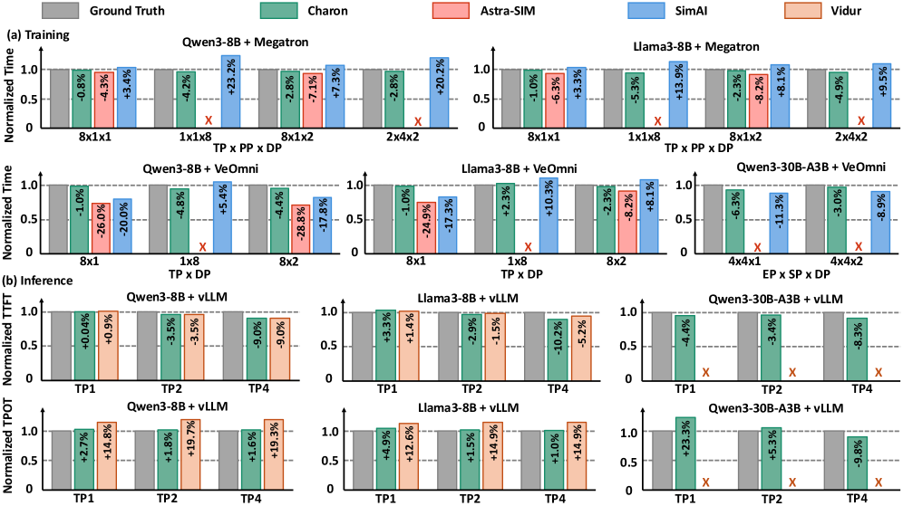
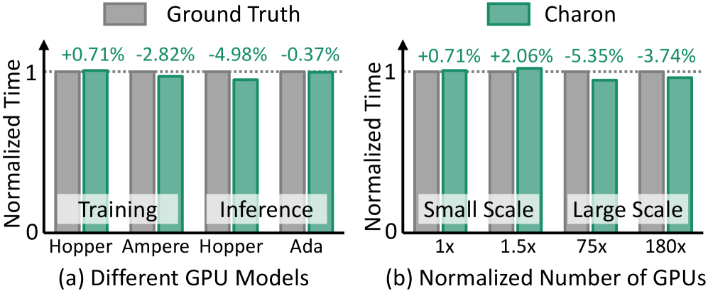
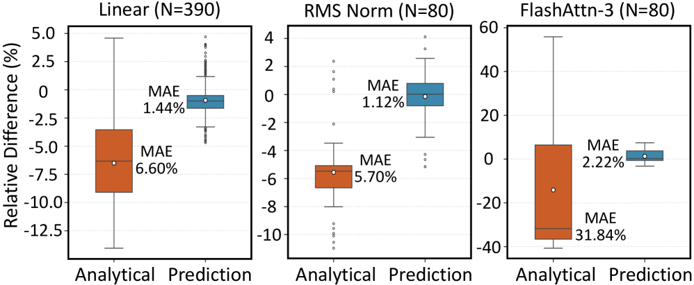
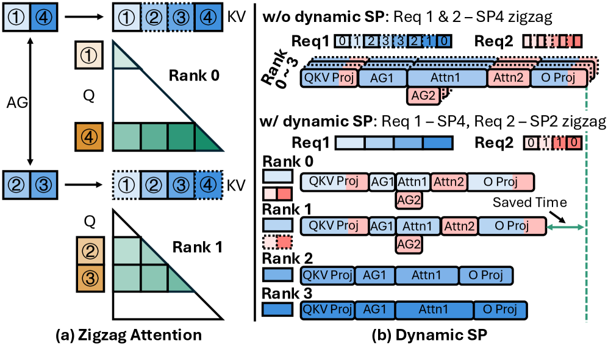
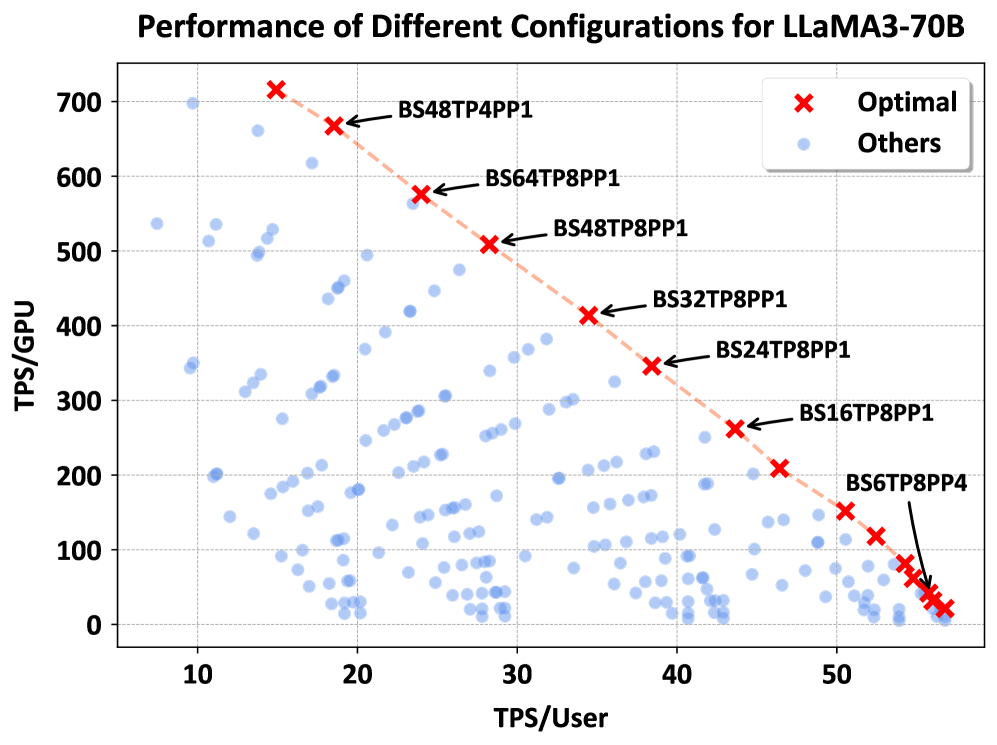

# Charon：先把 LLM 系统调优变成一次仿真

Mengtian Yang, Zhekun Zhang, Mingheng Wu, Jianwen Yan, Hanshi Sun, Li-Wen Chang · MLSys 2026

[MLSys Paper](https://proceedings.mlsys.org/paper_files/paper/2026/hash/dbc8ce0fdfcd55172d73fb05dbae07fc-Abstract-Conference.html) · [arXiv v2](https://arxiv.org/abs/2605.17164v2)（2026-05-16 首次发布，依据 2026-05-19 的 v2；本文于 2026-10-14 核对）

训练或部署一个大模型，真正难的常常不是把它跑起来，而是找出并行策略、批大小、硬件和网络拓扑的合适组合。配置选错会让 GPU 空等通信，也可能让一次实验消耗数百 GPU 小时；可要知道配置好不好，传统做法又必须先在真实集群上运行它。

Charon 把这类“如果换一种并行方式会怎样”的问题交给仿真器。它从 HuggingFace、vLLM 或 PyTorch 模型生成算子图，在图上模拟并行策略与通信，再按算子选择实测、机器学习预测或分析模型。论文在多种模型和配置上报告总体预测误差低于 5.35%；在接近一万 GPU 的训练配置上，误差低于 3.74%。

## Why Charon?

一次 LLM 训练要经过前向、反向和优化器更新；推理则包含 prefill 与逐 token decode。模型还要分布到多张卡上：Tensor Parallelism（TP）切权重，Pipeline Parallelism（PP）切层，Data Parallelism（DP）复制模型处理不同样本，MoE 还会引入 Expert Parallelism（EP）。每增加一种并行组合，计算与通信的先后依赖、硬件链路和内存占用都会改变。

最直接的答案是上真实集群跑 profiling。但每个配置点都要启动任务、预热并采集执行轨迹；而可能的并行度、GPU 类型和优化组合远多于工程师能逐一试验的数量。模拟器可以缩短这条反馈环，却长期分成训练专用和推理专用工具，有的要求手工重建模型，有的只接受预先生成的 trace；算子粒度、通信建模和图优化能力也各不相同。工程师于是仍要在多个工具间转换输入，难以从同一模型一路追踪到端到端结果。

Charon 要解决的核心问题因此是：**能不能直接从真实模型出发，在同一个执行图里同时推演算子、并行通信与系统配置？**

## How Charon Works

### 关键洞察：仿真可以像编译一样逐步改写模型

Charon 把仿真视为一连串计算图变换。输入模型先被追踪成算子图，随后依次应用优化、并行化、调度与分析 pass；执行后端为图中的算子估时，分析器再把局部结果组合成内存、延迟和执行时间线。

这条路径同时回应了两个常见取舍：手写抽象模型容易跑得快，却可能丢掉真实模型的算子结构；真实 profiling 足够贴近硬件，却无法低成本穷举配置。把图结构与算子估时分开，Charon 可以保留模型细节，同时为不同算子选择不同精度与成本的估算方式。



> 来源：原论文 Figure 3。读图重点：前端负责描述“执行什么、如何并行”，后端负责估算“每个算子要多久”，搜索器再组合两者探索配置。

1. **原生模型进入图前端：** Charon 使用 `torch.fx` 或 `torch.compile` 追踪 HuggingFace、vLLM 和自定义 PyTorch 模型；训练场景通过 AOT Autograd 从前向图生成反向图。对结构对称的模型，它可以只模拟一个 Transformer block 来降低成本；不对称模型或需要 PP 时，则分别追踪层并显式安排各 rank 的依赖。Prefill 和 decode 也可以拆成独立图，因此可以表达两阶段落在不同硬件集群上的 disaggregated serving。
2. **Pass 把并行和优化写进图：** TP、SP、EP 等切分会调整算子张量形状，并插入 All-Reduce、All-Gather、Reduce-Scatter 等通信算子；PP 会插入 rank 间的 send/recv 与调度依赖，支持 1F1B 和 DualPipe。FSDP、ZeRO 的参数/优化器状态切分与预取也能进入分析。融合、重排、重计算和量化可以作为图变换加入，因此系统能在同一执行图上比较优化前后的算子耗时、通信依赖与内存占用。
3. **混合后端给算子估时：** profiling engine 查询目标硬件上的实测数据库；预测 engine 为每类算子训练轻量随机森林，根据算子类型和张量形状估计 profile 数据库没有覆盖的形状；分析 engine 用 Roofline 估算计算算子，并按拓扑、校准链路延迟和有效带宽建模通信。Fused backend 会按每个算子可用的数据选择后端，缺少实测与预测时再回退到分析模型。

Figure 4 把前两步展开：从原生模型追踪出前向图和反向图，再通过优化、并行化与分析 pass 逐层改写。这样做的关键是，新策略作为图变换加入后，可以沿用同一套执行和分析流程。



> 来源：原论文 Figure 4。读图重点：图追踪把模型变成统一的中间表示，后续 pass 再表达 operator fusion、重计算、并行切分和 timeline / memory 分析。

Figure 5 则放大了算子估时这一步。实测数据库既供 profiling engine 查表，也为随机森林 predictor 提供训练数据；分析引擎承担可覆盖但精度较粗的后备估算，fused engine 按每个算子的可用数据组合这些路径。



> 来源：原论文 Figure 5。读图重点：所谓“混合”不是给整张模型图选一个估时方法，而是可以对不同算子分别选 profile、prediction 或 analytical 路径。

图级分析不仅汇总算力和通信，还会在反向图上跟踪张量何时分配、何时最后一次使用、何时释放，据此估算 activation 与临时 buffer 的峰值内存。这比只按参数量和张量静态大小估内存多了一层生命周期信息，对 FSDP、ZeRO 和 activation checkpointing 等内存敏感设置尤其重要。

仿真中的“重叠”也不是简单把计算时间与通信时间相减。计算与通信重叠时，Charon 对重叠区间施加由目标集群 profiling 校准的 slowdown；多个通信算子争用同一链路时，则按拓扑层级计算有效带宽竞争，再据此调整各算子的重叠时长。最后，design explorer 对 GPU 数、并行度和批大小等组合进行搜索，并允许用户预先定义剪枝规则，跳过已知低效的子空间。



> 来源：原论文 Figure 6。读图重点：两个通信算子若同时占用同一层级链路，就会分摊带宽并延长执行时间；把这种竞争放进 timeline，才能进一步估算通信与计算重叠后的端到端耗时。

## Results

端到端评测覆盖两个 dense 模型 Qwen3-8B、LLaMA3-8B，以及 MoE 模型 Qwen3-30B-A3B。训练侧在 Megatron 和 VeOmni 框架下与 Astra-SIM 2.0、SimAI 比较；推理侧基于 vLLM 与 Vidur 比较。论文称这些基线都经过修正以支持新模型，并按 profiling 结果重新校准。下图直接对照了仿真耗时和真实 profiling：横跨多种模型、框架与并行配置，Charon 的误差整体较小；图中的 X 表示该基线不支持对应配置或无法产生有效结果。



> 来源：原论文 Figure 7。读图重点：这是与其他仿真器的直接比较；各配置以硬件实测为 1，模型与配置不同，误差不能脱离对应面板横向混为一个单一分数。

跨硬件评测覆盖 H800/A100 训练卡与 H20/L20 推理卡；大规模训练配置组合 DP、PP、EP、SP、TP，规模接近一万 GPU。



> 来源：原论文 Figure 11。读图重点：实测与仿真的归一化端到端耗时在不同硬件和集群规模下接近；大规模训练结果支持 Charon 用于配置筛选，但不表示每个算子或任意新硬件都有同样误差。

论文报告跨模型与配置的总体预测误差低于 5.35%，跨硬件单步仿真误差在 4.98% 以内；近万卡训练误差低于 3.74%。细粒度结果也能对上：例如 Qwen3-8B 在 NVIDIA Ampere 上 TP8 训练时，forward attention 的实测耗时为 1842 微秒，Charon 预测为 1770 微秒；MoE 内存实验则在 Qwen3-30B-A3B、8 卡 FSDP、batch size 2、序列长 8192 下，最大 allocated 与 reserved 内存误差分别为 +0.39% 和 +0.29%。这些数字各自对应特定工作负载，不能视作统一的逐算子误差上限。

论文也用算子级消融解释为什么要保留多个估时后端。对数据库未覆盖的输入形状，Roofline 分析模型在 Linear 和 RMSNorm 上的 MAE 分别为 6.60% 和 5.70%，在 FlashAttention-3 上升到 31.84%；基于 profile 数据训练的预测器，对应 MAE 为 1.44%、1.12% 和 2.22%。结果说明分析模型适合作为覆盖面广的兜底，而复杂 fused kernel 的精度更依赖实测数据和预测器。



> 来源：原论文 Figure 10。读图重点：预测器并非脱离实测“凭空泛化”，其训练数据来自 profiling database；实验比较的是 unseen tensor shapes，不代表任意新 GPU 都能直接达到同样误差。

仿真不只复刻已有配置，也被用来提出新的系统方案。第一项案例针对 prefill 阶段的 sequence parallelism：固定的 zigzag attention 会把短序列切得过碎，新增的 All-Gather 通信可能比并行计算节省的时间还多。Charon 据此为 batch 中每条请求分别选 SP 度数——长序列保留 zigzag 均衡计算，短序列则减少切分；在 LLaMA-3 70B、8 张 NVIDIA Ada Lovelace GPU 上，这让 attention block latency 相比固定 zigzag 基线平均降低 15%。这是 attention 模块时延，不等同于端到端请求吞吐提升。



> 来源：原论文 Figure 12。读图重点：同一个 batch 中，长短请求可以走不同的 SP 计划；系统通过逐请求调整计算分片，减少短序列额外的 All-Gather 开销。

第二项案例把推理调优写成多目标搜索。对于 LLaMA-3 70B，Charon 在两分钟左右搜索不同 TP/PP 和 batch size 组合，绘制每用户吞吐 TPS/user 与每 GPU 吞吐 TPS/GPU 的 Pareto 前沿。红色配置点代表在给定用户侧性能约束下更优的配置；论文报告放宽 TPS/user 约束时，TPS/GPU 最优值最高可提高 7 倍。这个 7 倍描述的是不同延迟约束下前沿上的系统吞吐变化，不是对某个手工 baseline 的统一加速比。



> 来源：原论文 Figure 13，NVIDIA Hopper 推理 GPU。读图重点：调优目标不是单独最大化吞吐，而是在用户侧延迟约束下寻找更高的 GPU 利用效率。

仿真成本仍取决于校准数据。profiling 与预测后端都依赖预先测得的算子延迟；新硬件或未覆盖算子需要补充 profiling，分析后端的通信模型也使用校准后的链路参数。论文承认系统没有确定性地模拟网络抖动、动态拥塞和数据相关的 kernel 波动，因此小幅差异仍会存在。模型评测集中在 decoder-only Transformer 家族，图中“只模拟一个 block”的提速也主要适用于层结构对称的模型。论文和 MLSys 页面未提供可核实的公开代码链接（截至 2026-10-14），因此本文不附 Quick Start 命令。

## Conclusion

**Charon 把 LLM 性能仿真的核心单位从手工 workload 描述换成了原生模型的算子图。** 图变换表达并行与优化，混合后端补上算子与通信的成本，端到端误差与调度案例共同说明：仿真可以先筛选值得上集群验证的配置。

**它带来的视角变化，是把系统调优从“跑一次、看一次”推进到“先仿真、再验证”。** 这能减少配置探索的成本；但硬件校准、profiling 覆盖和运行时波动仍决定仿真的可信范围。

## Sources

- [MLSys 2026 论文页面与 PDF](https://proceedings.mlsys.org/paper_files/paper/2026/hash/dbc8ce0fdfcd55172d73fb05dbae07fc-Abstract-Conference.html)
- [arXiv 2605.17164v2](https://arxiv.org/abs/2605.17164v2)，2026-05-19 更新版本，本文于 2026-10-14 核对

## Citation

```bibtex
@inproceedings{MLSYS2026_dbc8ce0f,
  author    = {Yang, Mengtian and Zhang, Zhekun and Wu, Mingheng and Yan, Jianwen and Sun, Hanshi and Chang, Li-Wen},
  booktitle = {Proceedings of Machine Learning and Systems},
  editor    = {A. Chowdhery and Z. Jia},
  pages     = {94--107},
  publisher = {MLSys},
  title     = {Charon: A Unified and Fine-Grained Simulator for Large-Scale LLM Training and Inference},
  url       = {https://proceedings.mlsys.org/paper_files/paper/2026/file/dbc8ce0fdfcd55172d73fb05dbae07fc-Paper-Conference.pdf},
  volume    = {8},
  year      = {2026}
}
```
