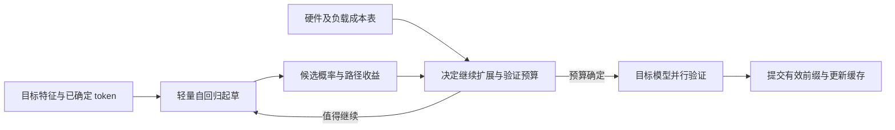
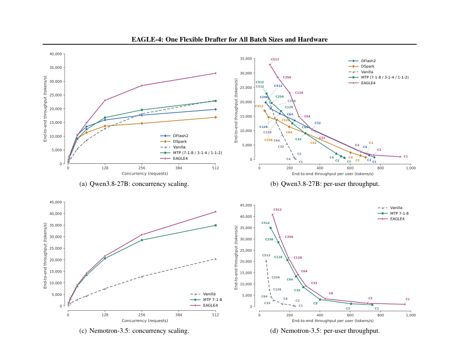

# EAGLE-4：让推测计算随硬件与负载调整

EAGLE-4 Team · Eagle AI · 2026 年预印本

[Paper](https://github.com/eagle-hq/EAGLE-4/blob/main/EAGLE4_Paper.pdf) · [Code](https://github.com/eagle-hq/EAGLE-4) · [Models](https://huggingface.co/EAGLE-Corp/Qwen3.8-27B-EAGLE4)

推测解码让小模型先猜、大模型批量检查，把一次昂贵前向换成多个有效 token。但猜得多不等于生成得快：服务器空闲时值得扩展的候选树，在高并发时可能挤占真正需要的计算资源。接受长度回答了“猜中了多少”，却没有回答“这些猜测值不值得算”。

EAGLE-4 保留轻量自回归起草，把控制目标换成预计收益与实际成本的平衡。论文 Table 2 报告：Qwen3.8-27B 在 4× NVIDIA B300、TP4、SPEED-Bench qualitative split、温度 0 下，单请求吞吐为普通解码的 3.59 倍；512 并发时仍为 1.34 倍。它的重点是用同一个目标模型对应的 drafter，在不同负载下选择不同的推测规模。

> 本文依据官方仓库公开 PDF，核对日期为 2026-11-04；日期采用官方 changelog 的首次发布日 2026-10-20。该 PDF 未标注 arXiv 版本号，本文对应的 [PDF 提交为 `7543671`](https://github.com/eagle-hq/EAGLE-4/blob/75436712e7415d352cf9f17d070019d07410786f/EAGLE4_Paper.pdf)。论文结果与持续更新的工程结果分别引用，文中命令未经 GPU 实测。

## 为什么更长的草稿不一定更快

普通自回归解码每轮只向前走一个 token。小批量推理经常受内存带宽限制，读取大模型权重后只完成少量计算；推测解码则用轻量 drafter 生成候选，再让目标模型并行验证。候选正确时，一轮就能前进多步；首次不接受的位置之后，剩余候选被丢弃。

并行起草是自然的改进方向。[DFlash](/papers/2026/DFlash/) 一次前向产出整块候选，[DFlash 2](/papers/2026/DFlash2/) 进一步改善块内连贯性与后缀质量。但块生成得快，不代表整个块都有使用价值：负载升高后，起草和验证都更贵，最合适的推测长度可能缩到一两个 token。

[DSpark](/papers/2026/DSpark/) 已经根据置信度和负载选择验证前缀，因此不能把它描述成完全静态的方法。区别在于决策发生的时间：缩短验证前缀能省下验证开销，却不能收回已经完成的块起草。EAGLE-4 将决策放到自回归扩展过程中，在计算下一步之前判断是否值得继续。

问题由此变得具体：下一层候选预计多带来的有效 token，能否抵偿它增加的起草和验证时间？

## 前置工作：系列演进与路线差异

### EAGLE 系列分别改变了什么

下表依据 EAGLE-4 §2.2 对系列的回顾及其引用的原始工作整理。它比较设计变化，不把不同模型、硬件上的历史加速结果排列成排行榜。

| 工作 | 输入与训练重点 | 候选组织方式 | 主要推进与边界 |
|---|---|---|---|
| [EAGLE](https://arxiv.org/abs/2401.15077) | 目标模型特征与前移一位的 token embedding；特征回归与 token 预测 | 固定草稿树 | 利用特征起草，并显式提供采样后的 token 信息 |
| [EAGLE-2](https://arxiv.org/abs/2406.16858) | 复用 drafter，无需为动态树重新训练 | 根据路径概率扩展、筛选动态树 | 让计算优先分配给有希望的分支，尚未显式计入硬件成本 |
| [EAGLE-3](https://arxiv.org/abs/2503.01840) | 融合低、中、高层特征；去掉特征回归，通过 training-time test 适应自身输出回馈 | 兼容动态树 | 改善连续起草时训练输入与实际输入的差异 |
| [EAGLE-3.1](https://arxiv.org/abs/2605.09992) | drafter 隐状态后归一化，捕获的目标隐状态分别 RMSNorm | 延续自回归起草 | 调整表示的归一化与稳定性 |
| EAGLE-4 | 延续轻量自回归架构，加入候选检索式 LM head | 按成本控制深度、宽度及验证预算 | 让接受收益与当前硬件、负载的成本共同决定推测规模 |

### 与其他起草路线的区别

| 路线 | 候选如何产生 | 位置依赖与动态控制 | 成本取舍 |
|---|---|---|---|
| MTP | 使用目标模型随附的预测头；具体实现依模型而异 | 本文实验使用链式推测并按并发调整配置 | 集成方便，但不能据此假定所有 MTP 都使用同一种策略 |
| DFlash | 块扩散 backbone 一次并行起草 | 块内共同建模；不能等同于逐分支自回归条件化 | 降低串行延迟，块大小与计算规模仍需选择 |
| DFlash 2 | 并行 backbone 加候选路径选择和局部卷积 | 用轻量模块改善连贯性与后段预测 | 保留并行优势；已生成但不验证的后缀仍有成本 |
| DSpark | 并行 backbone 加轻量顺序头 | 顺序修正，并依据置信度与服务成本选择验证前缀 | 兼顾依赖与并行性，动态验证不等于提前停止整个 backbone 的计算 |
| EAGLE-4 | 单层自回归 drafter 逐步扩展树或链 | 分支条件化；同时调整起草与验证预算 | 仍有串行步骤，通过便宜的单步与提前停止控制总成本 |

DFlash 与 DSpark 也可以采用动态树或链策略。EAGLE-4 的论点是自回归过程能利用每一步已经产生的分支信息，而不是其他路线在原理上无法动态调整。路线差异也不能直接推出性能胜负，仍须看具体实现和同条件实验。

## 如何把收益与成本放进同一个决策

### EAGLE-Harness：每一次扩展都有价格

Harness 在预热阶段测量不同批大小、上下文长度和验证规模下的执行成本，并缓存为查询表。推理时，drafter 给出候选概率；沿分支相乘的概率近似该路径的接受可能性。两类信息合起来，才知道扩展是否划算。

论文 §3.1 将判断概括为：

$$
\frac{\Delta A}{\Delta C} \geq \tau
$$

这里 $\Delta A$ 是新增候选预计带来的接受 token 增量，$\Delta C$ 是额外起草或验证时间，$\tau$ 为决策阈值。这不是最终加速比公式，而是边际预算规则。更深分支的估计更不可靠，论文采用随深度提高的起草阈值。

Harness 在三个位置使用成本信息：决定是否继续起草一层；按候选收益选择送往验证的节点数量；根据负载限制分支宽度。轻负载可以容纳深而宽的树，重负载则偏向短链。这里的“一个 drafter”指每个目标模型使用同一份草稿权重，并非一份权重适配所有目标模型，也不代表所有实验使用完全相同的上限配置。



> 根据论文 §3.1–3.3 绘制。关键是成本表参与下一步计算的决策，而非只在候选生成结束后截断输出。

采样模式还多一项约束。若根据本轮刚采样的 token 决定停止，可能引入选择偏差；论文因此在每轮开始前，用上一轮对应的停止深度确定本轮深度。配合正确的拒绝采样验证，目标是保持目标模型的输出分布。这不意味着随机采样两次必须得到逐字相同的文本。

### Efficient LM Head：低秩负责找，原矩阵负责打分

自回归起草每一步都需要把隐状态映射到词表。backbone 足够小后，这个 LM head 反而可能成为主要开销。固定缩小草稿词表可以省计算，但会排除部分有用 token。

EAGLE-4 保留完整词表上的动态候选检索。先用低秩近似给全词表粗打分，找出 128、256 或 512 个候选，再抽取原始 LM head 的对应行，为候选计算精确 logits。因此低秩部分只需擅长找候选，无需精确拟合整个分布；候选集合也会随当前隐状态变化。

“精确”只指被选中候选的 logits，不表示候选集合之外的概率质量消失，也不表示检索永不漏掉正确 token。论文冻结 drafter 的其他部分，专门训练低秩因子用于检索。在其 Qwen3.8-27B 实验中，rank 128、128 个候选的 top-1 覆盖率由 SVD 初始化的 91.5% 提升到 98.2%；接受长度未出现超过运行噪声的下降，单请求每验证周期的起草时间由 9.1 ms 降为 4.8 ms（§3.2）。

论文 Figure 2 的另一组单次前向剖析中，完整 head 的总延迟为 574 μs，rank 512 与 rank 128 分别为 326 μs 和 255 μs，即减少 43.2% 与 55.6%。这些是该剖析配置下的起草延迟，不能解释为端到端生成加速，也不能与每周期的毫秒数字混用。

### 长上下文不能让小模型背上大负担

如果目标模型已经采用稀疏或线性注意力，drafter 却仍读取全部历史，小模型也可能变成瓶颈。论文讨论稀疏注意力与滑动窗口，并在起草期间只追加缓存、不立即逐步驱逐旧条目，以简化管理。

这些是系统适配的一部分，并非所有已发布 checkpoint 都同时启用了所有选项。类似地，论文比较 MoE 与 dense FFN 后选择与目标架构对齐，没有给出“MoE drafter 在所有环境都更快”的结论。

## 实验：优势来自整个计算过程

主比较采用 Qwen3.8-27B，4× NVIDIA B300、TP4、SPEED-Bench qualitative split，最大输出 4,096 token；论文说明使用同一推理引擎并关闭 MegaKernel。512 并发将数据复制四次，以保持批次饱满。下表根据原论文 Table 2 重绘，吞吐单位均为 tokens/s，括号为相对同列普通解码的倍数。

| 方法 | T=0，单请求 | T=0，512 并发 | T=1，单请求 | T=1，512 并发 |
|---|---:|---:|---:|---:|
| EAGLE-4 | 863.8（3.59×） | 28,340（1.34×） | 608.6（2.59×） | 21,005（1.03×） |
| DFlash 2 | 672.6（2.80×） | 16,641（0.78×） | 560.3（2.39×） | 14,217（0.70×） |
| DSpark | 618.6（2.57×） | 14,229（0.67×） | 519.4（2.21×） | 11,723（0.58×） |
| MTP | 534.5（2.22×） | 21,518（1.01×） | 369.1（1.57×） | 18,869（0.93×） |
| 普通解码 | 240.5（1.00×） | 21,203（1.00×） | 234.9（1.00×） | 20,307（1.00×） |

单请求、T=0 下，EAGLE-4 的吞吐约为 DFlash 2 的 1.28 倍；512 并发时约为 1.70 倍。更值得注意的是后者的参照：此时两个块起草 baseline 已低于普通解码，EAGLE-4 仍保留收益。不过 T=1、512 并发只有 1.03 倍，表明高负载采样场景的余量已经很小。

这些结果包含配置选择。EAGLE-4 单请求采用 12-4-16 的深度、宽度、验证上限，高并发采用 15-1-16；MTP 分别采用 7-1-8 与 1-1-2。因此该表验证的是完整方法配置，而不能单独证明 LM head 或 Harness 各自贡献多少。



> 来源：原论文 Figure 3。横向比较并发增加时的总吞吐与单用户生成速度；各曲线属于完整服务配置。

论文 Figure 3 另外在 HumanEval 上画出 1–512 并发及每用户吞吐的关系。它比较完整服务配置，包含各自的注意力后端和调度设置，不能当成仅替换 drafter 的受控消融。闭环、复制数据维持高并发的实验，也不等于真实线上到达分布下的延迟 SLA。

### CPU 与手机说明了什么

论文 Table 5 使用 4-bit Gemma-4-E2B-it、llama.cpp、AWS c5.xlarge 的 4 vCPU / 8 GB 内存，温度 0、单请求。在 GSM8K、MATH-500、HumanEval、MT-Bench 上，EAGLE-4 相对普通解码分别为 2.87×、2.92×、2.76×、2.28×，加速比的算术平均为 2.71×。同表的 EAGLE-3 为 1.25×–1.65×，这是系列前作在相同 CPU 设置下的直接比较。

手机实验采用 Motorola Razr 70 Ultra 的 CPU、六线程运行，HumanEval 为 3.62×。这是冷机、尚未触发热降频的结果；论文报告连续生成约 30–45 秒后会触发热策略。ARM 内核、线程池及输出头等优化也包含在整个软件栈里，不能把增益全部归因于动态树，更不能推广为持续手机负载的稳定加速。

## 从哪里开始使用

截至核对日，官方仓库提供 `eagle-harness` 对 SGLang、vLLM 与 TokenSpeed 的集成。以下采用 README 的 Docker 探索路径，依据文档核对，未在本文环境实测；需要相匹配的 NVIDIA GPU、Linux 与 CUDA 驱动环境。

```bash
docker run --gpus all --ipc host -p 127.0.0.1:30000:30000 \
  -e HF_HOME=/hf -v ~/.cache/huggingface:/hf \
  ghcr.io/eagle-hq/eagle-4-sglang:0.1.3 \
  sglang serve --model-path Qwen/Qwen3.8-27B --host 0.0.0.0 \
  --disable-overlap-schedule --speculative-algorithm EAGLE_HARNESS \
  --speculative-draft-model-path EAGLE-Corp/Qwen3.8-27B-EAGLE4 \
  --speculative-num-steps 12 --speculative-eagle-topk 4 \
  --speculative-num-draft-tokens 16 \
  --speculative-algorithm-config '{}'
```

首次运行会下载约 62 GB 权重，还会编译内核与测量成本。生产集成应按[官方引擎指南](https://github.com/eagle-hq/EAGLE-4/tree/main/docs)固定匹配版本，完成预热，再与同引擎关闭推测的设置比较。该命令的镜像版本来自 README 示例，不代表 changelog 的最新版本。

当前 README 在其独立实测配置中报告 SGLang 单请求 3.42×，不同于论文的 3.59×；两者应各自引用，不能拼成一个实验。AMD 部分也有版本差异：论文 Table 4 写 MI350X，当前 README 列 MI355X，应按具体来源保留型号。

## 把计算预算交还给运行环境

EAGLE-4 将两个问题连在一起解决：先降低一次草稿预测的成本，再让运行时决定还值得做多少次。轻量自回归过程的串行性仍然存在，但也提供了逐步停止、分支扩展与利用最新信息的决策位置。

论文的证据支持在已测配置下跨负载调整推测预算的价值，而不是证明某种起草范式永远占优。对推理系统更有用的判断标准，是一轮增加的有效 token 能否抵偿它占用的时间，以及这个判断能否随硬件与服务负载及时变化。

## 资料

- [官方论文及源仓库](https://github.com/eagle-hq/EAGLE-4)
- [发布记录与版本差异](https://github.com/eagle-hq/EAGLE-4/blob/main/CHANGELOG.md)
- [官方引用信息：2026 年预印本](https://github.com/eagle-hq/EAGLE-4/blob/main/CITATION.cff)
- [DFlash 2 官方介绍](https://inco.ai/blog/dflash2/)
- [DSpark 原论文](https://arxiv.org/abs/2607.05147)
