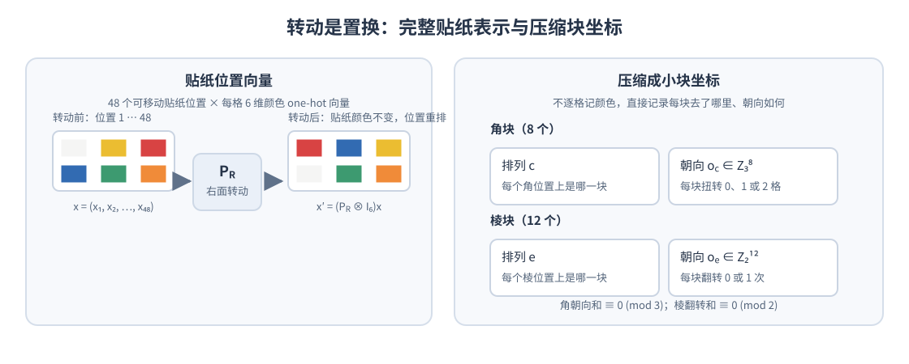

# 魔方的原理：线性代数

拿一只还原好的三阶魔方，把它摆成上白下黄、左绿右蓝、前红后橙。以魔方内部中心为原点，每个小块的位置都可以写成三维向量。转动某一个面，就是选出这一层的小块，让它们的位置和贴纸朝向一起旋转。

这条路线把线性代数和手里的魔方直接联系起来：先用空间坐标描述块，再用旋转矩阵描述动作，最后解释为什么这些动作也能写成置换矩阵，以及还原公式怎样由基本动作组合而成。

> 本文讨论普通三阶魔方，不追踪中心贴纸上的图案方向。只需了解向量、矩阵乘法和初中代数；不需要预先会还原魔方。`R` 表示右面顺时针转 90°，`R'` 表示逆时针转 90°，`R2` 表示转 180°。顺逆方向始终以正对该面的观察者为准。

## 一、从空间坐标建立魔方模型

### 1. 固定坐标系，给 26 个小块定位

以魔方内部中心为原点 $O$，建立右手空间直角坐标系：$x$ 轴向右，$y$ 轴向上，$z$ 轴向前。把相邻小块中心的间距设为 1，于是六个中心块的位置与初始颜色为：

| 面 | 记号 | 中心坐标 | 初始颜色 |
| --- | --- | --- | --- |
| 右 | `R` | $(1,0,0)$ | 蓝 |
| 左 | `L` | $(-1,0,0)$ | 绿 |
| 上 | `U` | $(0,1,0)$ | 白 |
| 下 | `D` | $(0,-1,0)$ | 黄 |
| 前 | `F` | $(0,0,1)$ | 红 |
| 后 | `B` | $(0,0,-1)$ | 橙 |

这里的“上白下黄”等颜色关系描述还原态；转乱后，上层当然可以出现其他颜色。建模过程中坐标轴固定，不跟着某个面转动。

用列向量表示第 $i$ 个块的当前位置：

$$
p_i=\begin{bmatrix}x_i\\y_i\\z_i\end{bmatrix},
\qquad x_i,y_i,z_i\in\{-1,0,1\},\qquad p_i\ne0.
$$

这恰好给出 $3^3-1=26$ 个位置。按非零坐标的个数，就能区分三种块：

- 中心块只有一个非零坐标，共 6 个，例如右中心 $(1,0,0)$。
- 棱块有两个非零坐标，共 12 个，例如右上棱 $(1,1,0)$。
- 角块有三个非零坐标，共 8 个，例如右前上角 $(1,1,1)$。

也可以通过长度区分它们：中心、棱、角的位置向量长度分别为 $1$、$\sqrt2$、$\sqrt3$。旋转保持长度，因此三类块不会互相变成另一类。

需要区分“块”和“位置”：位置 $(1,1,1)$ 永远表示右前上角的槽位，但占据它的角块会随转动更换。我们给每个实体块固定编号 $i$，它的颜色组合不变，$p_i$ 随动作更新。

### 2. 位置之外，还要记录贴纸朝向

只有 $p_i$ 还不能描述完整状态。一个角块可以位于正确槽位，却绕自身对角线扭转；棱块也可以在原位翻转。位置相同，表面颜色仍然可能不同。

对块上的每张贴纸，再记录一个朝外的单位法向量 $n_{i,c}$，其中 $c$ 是该贴纸固定的颜色。静止在整齐的层位时，它只能取六个方向：

$$
n_{i,c}\in\{\pm e_x,\pm e_y,\pm e_z\}.
$$

例如，还原态的白红蓝角块位于右前上角，它的状态为

$$
p_i=\begin{bmatrix}1\\1\\1\end{bmatrix},\qquad
n_{i,\text{白}}=e_y,\quad
n_{i,\text{红}}=e_z,\quad
n_{i,\text{蓝}}=e_x.
$$

所以整个魔方可以用“每个块的位置 + 该块每张贴纸的颜色与法向量”描述。颜色绑定在实体块上，旋转改变的是位置和法向量。普通纯色中心只需记录一张贴纸的法向量；若是带箭头或图案的中心，还需要记录面内方向，本文不讨论这种额外状态。

### 3. 先推导右面转动 `R`

右面转动选择的是当前满足 $x_i=1$ 的 9 个块：4 个角块、4 个棱块和右中心。面对右面顺时针转 90°，在这里的右手坐标系中，就是绕 $x$ 轴转 $-90^\circ$。

绕 $x$ 轴的旋转矩阵为

$$
Q_x(\theta)=
\begin{bmatrix}
1&0&0\\
0&\cos\theta&-\sin\theta\\
0&\sin\theta&\cos\theta
\end{bmatrix}.
$$

代入 $\theta=-\pi/2$，得到

$$
Q_R=
\begin{bmatrix}
1&0&0\\
0&0&1\\
0&-1&0
\end{bmatrix},\qquad
Q_R\begin{bmatrix}x\\y\\z\end{bmatrix}
=\begin{bmatrix}x\\z\\-y\end{bmatrix}.
$$

对选中的每个块，位置和它的所有贴纸法向量都乘同一个矩阵：

$$
p_i'=Q_Rp_i,\qquad n_{i,c}'=Q_Rn_{i,c}.
$$

仍以前面的白红蓝角块为例：

$$
\begin{bmatrix}1\\1\\1\end{bmatrix}
\xrightarrow{R}
\begin{bmatrix}1\\1\\-1\end{bmatrix}.
$$

它从右前上角移到右后上角。贴纸方向同时变化：

$$
e_y\mapsto-e_z,\qquad e_z\mapsto e_y,\qquad e_x\mapsto e_x.
$$

于是白色朝后、红色朝上、蓝色仍朝右。这一步既解释了块去了哪里，也解释了它为什么会改变朝向。

右中心则满足 $Q_R(1,0,0)^T=(1,0,0)^T$，其蓝色法向量 $e_x$ 也不变。中心块随层转动，但普通纯色中心的可见状态不变。

### 4. 六个面都是“选层，再旋转”

沿用同一坐标系，六个顺时针四分之一转动可以统一写成下表。选择条件检查的是动作执行前的当前位置；转动之后，块仍落在整数坐标槽位上。

| 动作 | 选中的层 | 绕正坐标轴的角度 | 选中块的位置更新 |
| --- | --- | --- | --- |
| `R` | $x=1$ | 绕 $x$ 轴 $-90^\circ$ | $(x,y,z)\mapsto(x,z,-y)$ |
| `L` | $x=-1$ | 绕 $x$ 轴 $+90^\circ$ | $(x,y,z)\mapsto(x,-z,y)$ |
| `U` | $y=1$ | 绕 $y$ 轴 $-90^\circ$ | $(x,y,z)\mapsto(-z,y,x)$ |
| `D` | $y=-1$ | 绕 $y$ 轴 $+90^\circ$ | $(x,y,z)\mapsto(z,y,-x)$ |
| `F` | $z=1$ | 绕 $z$ 轴 $-90^\circ$ | $(x,y,z)\mapsto(y,-x,z)$ |
| `B` | $z=-1$ | 绕 $z$ 轴 $+90^\circ$ | $(x,y,z)\mapsto(-y,x,z)$ |

每一行对应的三维矩阵，也作用于选中块的所有贴纸法向量。注意，先根据块的位置判断它是否在该层，再更新法向量；不能根据法向量本身选择贴纸，否则会把一个块的贴纸拆开移动。

以 `R` 为例，完整规则是

$$
(p_i',n_{i,c}')=
\begin{cases}
(Q_Rp_i,Q_Rn_{i,c}),&x_i=1,\\
(p_i,n_{i,c}),&x_i\ne1.
\end{cases}
$$

因此要区分两个层次：选中层内的位置和法向量由三维线性旋转更新；整个魔方的单面动作还包含选层条件，不能直接用一个 $3\times3$ 矩阵统一作用于所有块。若所有块都乘 $Q_R$，得到的是整个魔方的刚体旋转。

同理，把所有实体块的坐标直接拼成一个长向量，也不能让每个面动作都变成一个固定矩阵：同一个实体块这次是否参与转动，取决于它当前在哪一层。这是原始几何坐标和后面贴纸槽位编码之间的重要区别。

### 5. 为什么又可以写成固定的置换矩阵？

空间模型告诉我们如何计算动作。若希望用固定矩阵表示整个魔方上的动作，可以换一种编码：给固定的贴纸槽位编号，记录每个槽位当前是什么颜色。

一个贴纸槽位由 $(p,n)$ 确定：$p$ 是所在块的中心位置，$n$ 是该贴纸朝外的法向量。例如 $((1,1,1),e_y)$ 是右前上角朝上的贴纸槽位。三阶魔方共有 54 个这样的槽位，去掉 6 个固定中心，剩下 48 个。

几何规则把每个槽位映射到另一个槽位，因此对槽位的作用是固定的置换，与当前贴纸颜色无关。这正是从三维旋转得到置换矩阵的桥梁。

给 48 个可移动槽位编号 $1,\ldots,48$，用六维 one-hot 向量 $e_1,\ldots,e_6$ 分别编码白、黄、红、橙、蓝、绿，定义

$$
X=\begin{bmatrix}c_1\\c_2\\\vdots\\c_{48}\end{bmatrix},
\qquad c_j\in\{e_1,\ldots,e_6\}.
$$

这是一个 288 维列向量。令 $S_R$ 是 $48\times48$ 的槽位置换矩阵，若旧槽位 $j$ 被搬到新槽位 $k$，就令 $(S_R)_{kj}=1$。则

$$
X'=P_RX,\qquad P_R=S_R\otimes I_6.
$$

这里 $\otimes$ 是 Kronecker 积：$S_R$ 搬动槽位，$I_6$ 保持颜色编码不变。几何描述中的“选层再旋转”，现在成为了固定的 $288\times288$ 线性变换。合法颜色状态只占这个向量空间中的一个有限子集，不能把任意实向量都理解成魔方。

后文统一用 $Q$ 表示三维旋转矩阵，用 $P$ 表示整个贴纸状态上的转动矩阵。先做 `R` 再做 `U`，应写成

$$
X'=P_UP_RX.
$$

其中第二步 `U` 选择的是 `R` 执行后的上层，不能始终选择最初在上层的实体块。槽位编码已把这个更新包含在矩阵乘法中。

每个动作都可逆，且

$$
P_R^{-1}=P_{R'},\qquad P_R^4=I.
$$

例如打乱序列 `R U F'` 满足

$$
X_{\text{乱}}=P_{F'}P_UP_RX_{\text{解}}.
$$

倒序逐个取逆，还原序列就是 `F U' R'`：

$$
X_{\text{解}}=P_{R'}P_{U'}P_FX_{\text{乱}}.
$$

### 6. 再压缩成“块排列 + 块朝向”

现在有了两种完整描述：空间模型追踪每个实体块的位置和贴纸法向量；槽位模型追踪固定格子里的颜色。若要研究合法状态和求解算法，还可以进一步压缩为块坐标：

- 角块排列 $c$：8 个角槽位分别由哪个角块占据；角块朝向 $o_c$：按约定的参考贴纸和槽位方向，记录 $0,1,2$，按模 3 运算。
- 棱块排列 $e$：12 个棱槽位分别由哪个棱块占据；棱块朝向 $o_e$：按约定记录 $0,1$，按模 2 运算。

这里的“块坐标”是离散编码，区别于前面的三维空间坐标。朝向数字也不是直接把空间旋转角度除以 120° 或 180°，而是比较块的参考贴纸与所在槽位的参考方向；必须统一约定，才能相加并讨论不变量。Kociemba 给出了一套具体的参考贴纸定义及其复合规则。[Kociemba：The Cubie Level](https://www.kociemba.org/math/cubielevel.htm)

几何旋转、贴纸置换、块排列与朝向描述的是同一套动作。先通过空间模型看清动作，再用离散编码分析可达性，就可以理解下面的三个约束。

## 二、不是任意排列都能还原

如果 8 个角块和 12 个棱块都能任意排列、任意翻转，那么绝大多数想象中的状态都能从已还原状态得到。但实际转动保留了几个不变量。它们就像状态空间的“交通规则”：告诉我们哪些状态合法，哪些状态即使看起来只差一点，也无法通过正常转动到达。

### 角块扭转总和为 0（模 3）

把八个角块的朝向记为 $o_{c,1},\ldots,o_{c,8}\in\{0,1,2\}$，则任何由正常转动得到的状态都满足

$$
\sum_{i=1}^{8}o_{c,i}\equiv0\pmod 3.
$$

于是，不可能只把一个角块单独扭转 120° 而让其余部分不变。若自己把角块从魔方上拔下来再装回去，可能造出违反这个约束的状态；这不是还原公式失灵，而是魔方已经离开了正常转动所能到达的状态集合。

### 棱块翻转总数为偶数

把每个棱块的朝向记为 $o_{e,j}\in\{0,1\}$，则

$$
\sum_{j=1}^{12}o_{e,j}\equiv0\pmod 2.
$$

也就是说，一个棱块不能孤立翻转；翻转必须成对出现。直观地看，每次面转动都会改变一组棱块的朝向，翻转数的奇偶性不会因此改变。

### 角块排列与棱块排列的奇偶性相同

任意排列都有奇偶性：一次交换两个对象会改变奇偶性，三循环或四循环可按交换次数判断。把角块排列的奇偶性记为 $\operatorname{sgn}(c)$，棱块排列的奇偶性记为 $\operatorname{sgn}(e)$。合法状态满足

$$
\operatorname{sgn}(c)=\operatorname{sgn}(e).
$$

一次四分之一面转动会让角块排列和棱块排列同时变奇或同时变偶，所以两者奇偶性始终相同。结果是：不能只交换两个角块，也不能只交换两个棱块；这类状态需要拆块重装才可能出现。

这三个限制也解释了为何常见还原流程会先让某些块归位，再逐步缩小剩余可能性。人手不必搜索几十亿种安排：只需按层把局部目标做成，再用不会破坏已完成部分的公式处理剩下的块。

## 三、还原公式不是凭空背出来的

还原公式是一串基本面转动。它们的设计目标是：让某一块或一组块发生需要的变化，同时使已经处理好的部分在整串动作结束时恢复。

先看公式

$$
R\ U\ R'\ U'.
$$

它可以看成一个**换位子**：先做 $R$、再做 $U$，然后把这两步按相反顺序撤销（$R'$、$U'$）。如果 $R$ 和 $U$ 完全互不影响，整串动作就会抵消成原状；但它们在右上角相交，会共同作用于那一小片区域，于是局部块留下了净变化。其他位置大多被带出又带回。

用矩阵写，令 $A=P_R$、$B=P_U$，则这组动作是

$$
B^{-1}A^{-1}BA.
$$

（这里仍按“从右向左作用”读矩阵乘积。）关键不在于矩阵乘法神奇地解出了魔方，而在于操作次序让 $A$ 与 $B$ 的影响相互抵消，只留下它们交界处的差别。这正是许多短公式的来源。

### 从一个局部动作得到更多公式：共轭

假设我们已经找到一串动作 $T$，能对某个位置附近做想要的事。再选一串准备动作 $S$，把目标区域转到 $T$ 擅长处理的位置；做完 $T$ 后，撤销准备动作。按实际执行顺序写，总序列是

$$
S\ T\ S^{-1}.
$$

它叫**共轭**。前后两段互逆，因此最后会把“准备时的坐标变化”撤销，但中间动作造成的目标效果会被搬到另一个位置。因为动作序列按书写顺序执行，列向量上的矩阵乘积为

$$
P_{S T S^{-1}}=P_{S^{-1}}P_TP_S.
$$

左侧的下标表示按书写顺序执行动作；右侧矩阵仍按从右向左作用。也就是说，列向量先乘 $P_S$，再乘 $P_T$，最后乘 $P_{S^{-1}}$。这和上面“动作序列倒过来、每步取逆”的规则一致。

可以用顶层黄色十字公式看一次这种构造。先把

$$
T=R\ U\ R'\ U'
$$

当作局部触发，再在它前后加上 `F` 和 `F'`，得到

$$
F\ T\ F'=F\ R\ U\ R'\ U'\ F'.
$$

这正是黄色十字步骤使用的公式。首尾的 `F`、`F'` 把触发动作的作用位置搬到顶层棱块上；中间的 $T$ 让顶层棱块朝向发生所需变化。若先用 `U` 把黄色棱块摆成合适的“一字”或“拐角”，这一串动作会恢复底下两层，并把顶层推进到下一种形状，重复后即可得到十字。可达状态约束也保证棱块翻转总数为偶数，所以黄色棱块不会只剩一个孤立翻转。

例如，若一个触发公式只会在“右前上角”附近交换或调整块，那么把目标块通过 $U$、$D$ 等准备动作送到那里，执行触发，再撤销准备，就得到另一组适用于新位置的公式。这也是新手公式看起来相似、只差几个撇号的原因：它们常常是同一个局部动作经过不同摆放方式得到的。

## 四、跟着一套分层方法还原

前面建模时固定上白下黄；为了采用常见的新手分层公式，下文将整只魔方绕前后轴翻转 180°，重新持握为白色底面、黄色顶面、红色前面。此时左蓝右绿。下文的字母按新的持握方向命名，不再沿用前面固定坐标系中的面名；这次整体换向不算作打乱动作。`F` 是正对自己的前面，`R` 是右面，`U` 是顶面，`D` 是底面，`L` 是左面。每个公式都必须在指定朝向下使用；转动方向以面对相应面为准。

### 第一步：做出白色底层十字

找到四个带白色贴纸的棱块，把它们逐一送到白色中心周围，使棱块另一面的颜色也与相邻中心对齐。这个步骤主要靠观察，不需要背固定公式：先把目标棱块移到顶层，再转顶层对准侧面中心，最后把它送到底层。

这里“白色十字完成”不只是底面出现四个白色贴纸。四个棱块的侧面颜色也要分别对上红、蓝、橙、绿等中心，否则块的位置尚未正确。

### 第二步：插入白色角块

将白色朝下，找到一个白色角块，转动顶层把它放到目标底角的正上方。把目标底角放在右前方，反复使用

$$
R\ U\ R'\ U'.
$$

每做一次都观察该角块的位置和朝向；到位后停止，再处理下一个角块。若角块已在底层却方向不对，先用同一组转动把它带回顶层，再按目标位置重新插入。

为什么这四步常能保住底层十字？执行时，中间两步会暂时带动底层附近的块；后两步反转右面动作并补回顶层动作，使大部分变化复原。剩下的影响集中在公式经过的角块和棱块上。可以把它理解成前一节“做一个局部动作，再把准备步骤撤销”的入门例子：观察每一小步的块位置，就能发现公式靠的是抵消而不是运气。

### 第三步：插入中层棱块

找顶层中不含黄色的棱块，转动 `U` 让其前侧颜色对齐前面中心。判断棱块要插到右侧还是左侧：

- 目标在右侧：`U R U' R' U' F' U F`
- 目标在左侧：`U' L' U L U F U' F'`

以右插入为例，先用 `U R U'` 把目标位置和右侧通道摆好，再用 `R' U' F' U F` 完成插入并恢复上层关联块。左插入是左右镜像。这里的准备动作与撤销动作并非简单相邻抵消，因为棱块要通过侧面进入中层；观察目标棱块的轨迹，能看出公式是把它送入空槽，同时把原槽附近的块带回。若顶层没有合适的棱块，就先对一个错误的中层棱块执行其中一条公式，把它弹回顶层，再重新插入。

### 第四步：做出黄色顶层十字

忽略黄色角块，只看顶层棱块的黄色贴纸。对顶面使用

$$
F\ R\ U\ R'\ U'\ F'.
$$

若是“一字”，把黄棱横放；若是“拐角”，让两条黄棱分别朝后和朝左；若只有中心黄色点，任选一个方向执行后重新观察。重复到顶面出现黄色十字。两侧 `F` 与 `F'` 把前面暂时打开再关上，中间动作改变顶层棱块的方向；因此底下两层在公式结束时恢复。

### 第五步：把黄色角块翻到顶面

保持黄色朝上，把一个黄色未朝上的角块放在右前上角，重复

$$
R'\ D'\ R\ D
$$

直到该角块的黄色贴纸朝上。然后**只转动顶层 `U`**，把下一个未完成角块送到右前上角，继续重复。过程中底层会暂时被打乱；不要转动整个魔方，也不要在某个角刚朝上时中断四步循环。全部四个角完成后，先前插好的底层和中层会恢复。

这组公式把目标角块临时送入右下方，再把它送回来时改变朝向。单个角不能独自扭转，所以操作的中间状态还会带动其他角；绕一圈处理完所有顶角后，扭转总和仍满足模 3 约束。这是“中途看起来变乱，整轮结束后却能复原”的典型例子。

### 第六步：把黄色角块放到正确位置

角块“位置正确”指它的三种颜色与周围三个中心相邻；此时暂时不管黄色贴纸是否朝上。若已有一个角块在正确位置，把它放在右前上角，然后使用

$$
U\ R\ U'\ L'\ U\ R'\ U'\ L.
$$

这组动作循环调整顶层角块的位置。若没有正确角块，先从任意方向做一次，再观察；配合顶层 `U` 转动，让正确角块移到右前上角，重复到四个角都在正确位置。

从块坐标的角度看，这一步改变角块排列 $c$，但不改变角块朝向向量 $o_c$ 的合法性。公式是由转动序列组成，所以角块扭转和、角棱排列奇偶性等不变量自动保留；这比凭肉眼检查“会不会扭坏魔方”可靠得多。

### 第七步：循环黄色棱块，完成还原

最后观察四个侧面的顶层棱块。若已有一个棱块侧面颜色对齐，把它放在后面；使用

$$
R\ U'\ R\ U\ R\ U\ R\ U'\ R'\ U'\ R2
$$

观察其余三条棱的循环方向。若方向相反，就使用这个公式的逆序逆转版本；如果没有一条棱已对齐，先执行一次，再重新寻找已对齐的棱。最后用 `U`、`U'` 或 `U2` 对齐顶层与侧面中心。

到这里，角块和棱块的位置、朝向都回到解态，贴纸状态向量也回到初始向量。若一条棱单独翻转、一个角单独扭转，或只有一对同类块互换，先检查是否有块曾被拆下重装：这些状态违反了前面推导的可达约束，正常转动公式无法修复。

::: warning
**转动方向与公式方向**

上面的公式按标准 Singmaster 记号书写，但不同教程可能采用不同的持握方向或公式变体。使用时保持白色底面、黄色顶面，并确认 `F`、`R`、`U` 等字母对应当前面对的方向。若公式执行后目标块轨迹和说明不符，先复位并检查握持方向，不要在不确定的状态下继续套公式。
:::

## 五、公式到底是怎样“推导”出来的

现在可以把整个还原过程连起来看。每条公式都是若干基本转动矩阵的乘积。要设计一条公式，通常先选定目标（例如只调整顶层方向，或把一个棱块插入右侧中层），再安排一串动作，使不需要改变的块在后续步骤中回到原位。逆转动保证可撤销；换位子利用两个动作的交界留下局部效果；共轭则把这个效果搬到不同位置。

用状态记号写，若操作序列 $W$ 对应矩阵 $P_W$，那么把当前状态还原的目标是找到一串 $W$，使

$$
P_W X_{\text{当前}}=X_{\text{已还原}}.
$$

若知道从解态到当前状态的完整动作序列，其矩阵记为 $P_{\text{打乱}}$，那么取 $P_W=P_{\text{打乱}}^{-1}$ 就能还原。但当前颜色向量本身不是可求逆的方阵，也不能唯一确定打乱矩阵：不同动作可能得到同一颜色状态。仅知道颜色状态，仍需寻找一串合法面转动，不能靠对状态向量“求逆”直接得到公式。新手方法选择“先完成一层、再保护已完成部分”，是用局部目标代替对庞大状态空间的直接搜索。

因此，线性代数在这里负责**准确描述状态变化、复合操作与逆操作**；排列与模运算揭示**哪些状态可达、哪些块的变化必须成组发生**；分层方法再把这些事实变成一套可操作的流程。背公式不是唯一的入口。理解每条序列如何搬动目标块、如何抵消多余变化，才是从数学上看懂魔方还原的关键。

## 参考资料

以下资料分别对应空间建模与离散状态分析。各资料的坐标轴和配色约定可能不同，使用矩阵前应先对齐约定。

- Tomas Cortes, [rubik-cube-model](https://github.com/tomascortes/rubik-cube-model)：用整数位置向量、三阶朝向矩阵与局部贴纸法向量建模，面转动选择一层的 9 个块，同时更新位置和朝向。
- A. J. Donich, [Exploring the Model's Code Implementation](https://ajdonich.github.io/rubiks-cube/implementation/)：给 54 张贴纸赋予三维整数空间坐标，用三维旋转矩阵实现面转动；与本文按实体块记录位置和法向量的方式有所区别。
- Daniel Shiffman / The Coding Train, [Rubik’s Cube — Coding Challenge 142](https://thecodingtrain.com/challenges/142-rubiks-cube)：从创建小块、矩阵驱动面旋转到旋转动画的三部分实现教程。

- Herbert Kociemba, [The Cubie Level](https://www.kociemba.org/math/cubielevel.htm)：角块、棱块的排列与朝向坐标，以及坐标复合规则。
- Tomas Rokicki, [Twenty-Five Moves Suffice for Rubik’s Cube](https://kociemba.org/math/papers/rubik25.pdf)：魔方可达状态的朝向与奇偶约束，并介绍两阶段求解思路。
