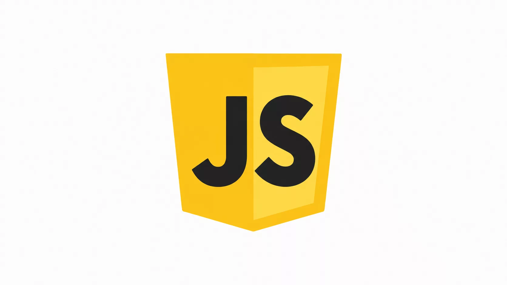

# JavaScript



本教程以你给出的 [MDN JavaScript 文档](https://developer.mozilla.org/zh-CN/docs/Web/JavaScript)为主线，按照其教程分类和《JavaScript 指南》的章节顺序重新讲解。内容用独立示例说明概念，不逐段复制 MDN 原文；MDN 页面中每个主题都在下方目录中保留，参考手册则链接回 MDN，方便查完整语法和兼容性。

JavaScript 是由宿主环境执行的编程语言。ECMAScript 规定语言本身；浏览器、Node.js 等宿主再提供 DOM、文件系统等各自的 API。本教程适合有基础编程常识的初学者，示例以现代浏览器和当前 Node.js LTS 为准。最后核对日期：2026-10-16。运行时版本和 API 兼容性会变化，使用前请查官方发布页。

## 学习路线

```text
入门：第一步 → 代码块 → 对象 → 异步 → 客户端 Web API
                                      ↓
指南：语法 → 流程 → 循环 → 函数 → 运算符 → 字符串与数字 → 日期
       → 正则 → 索引集合 → 键值集合 → 对象 → 类 → Promise
       → 类型化数组 → 迭代器 → 国际化 → 资源管理 → 模块
                                      ↓
中级：语言概述、数据结构、相等、属性、闭包
高级：原型链、元编程、内存管理、事件循环
                                      ↓
参考：内置对象、表达式、语句、函数、类、正则与错误
```

前五个入门主题适合第一次接触 JavaScript 的读者；《JavaScript 指南》假定你已经理解基本编程概念。中级和高级主题用于深化语言模型。参考章节是按需查找的索引，不必从头背诵。

## 教程

### 面向纯新手

以下章节对应 MDN 入门学习路径，按顺序学习：

1. [JavaScript 第一步](installation.md)：JavaScript 是什么、能做什么、如何运行；变量、字符串、数字与数组。
2. [创建 JavaScript 代码块](syntax.md)：条件、循环、函数、返回值和事件。
3. [介绍 JavaScript 对象](objects.md)：对象、属性、原型与类。
4. [异步 JavaScript](async.md)：回调、Promise、`async` / `await`、Worker 与异步流程。
5. [客户端 Web API](browser.md)：浏览器 API、DOM、网络请求、存储和浏览器能力。

### JavaScript 指南

以下 19 章按 [MDN《JavaScript 指南》](https://developer.mozilla.org/zh-CN/docs/Web/JavaScript/Guide)的章节结构排列。指南页正在逐章整理；每个条目均保留为学习主题，可点 MDN 链接查阅完整说明与兼容性。

1. [介绍](installation.md#javascript-与运行环境)：语言与宿主环境、ECMAScript、工具和 Hello World。
2. [语法与数据类型](syntax.md)：语法、注释、声明、作用域、提升、值类型和字面量。
3. [流程控制与错误处理](errors-debugging.md)：分支、异常、错误对象和处理策略。
4. [循环与迭代](collections.md#循环与可迭代对象)：循环语句、迭代协议与常见遍历方式。
5. [函数](functions.md)：声明、调用、参数、闭包、箭头函数和函数作用域。
6. [表达式与运算符](syntax.md#表达式与运算符)：赋值、比较、逻辑、算术、解构、展开与优先级。
7. [数字与字符串](strings-numbers.md)：数值表示、BigInt、字符串操作与转换。
8. [表达日期与时间](dates.md)：Date、时区、解析、格式化与时间计算。
9. [正则表达式](regular-expressions.md)：模式、字符类、断言、分组、量词和匹配结果。
10. [索引集合类](collections.md#数组与索引集合)：Array、TypedArray、数组方法与数据变换。
11. [带键的集合](collections.md#带键集合)：Map、Set、WeakMap 和 WeakSet。
12. [使用对象](objects.md)：属性、对象创建、访问器、枚举性、原型与复制。
13. [使用类](objects.md#类)：构造函数、字段、方法、继承、私有成员与静态成员。
14. [使用 Promise](async.md#promise)：Promise 状态、链式调用、组合和错误传播。
15. [JavaScript 类型化数组](typed-arrays.md)：ArrayBuffer、TypedArray 和 DataView。
16. [迭代器和生成器](iterators-generators.md)：可迭代协议、迭代器、生成器与异步迭代。
17. [资源管理](resource-management.md)：显式资源管理、`using` 与 `await using` 的适用场景。
18. [国际化](internationalization.md)：Intl 日期、数字、排序和本地化格式。
19. [JavaScript 模块](modules.md)：导入、导出、动态导入与模块组织。

### 中级主题

1. [理解客户端 JavaScript 框架](frameworks.md)：在掌握原生 JavaScript 后了解框架解决的问题。
2. [JavaScript 语言概述](language-overview.md)：语法与执行模型的总览。
3. [JavaScript 数据结构](collections.md)：原始值、对象、集合及选择依据。
4. [相等比较和相同](equality.md)：`===`、`==`、`Object.is()` 的差异。
5. [属性的可枚举性和所有权](objects.md#属性枚举与所有权)：判断属性来自对象自身还是原型，以及枚举行为。
6. [闭包](functions.md#作用域与闭包)：函数如何保留声明时的词法环境。

### 高级主题

1. [继承与原型链](objects.md#原型链)：属性查找和原型继承的运行机制。
2. [元编程](metaprogramming.md)：Proxy、Reflect、属性描述符和反射操作。
3. [内存管理](memory-management.md)：可达性、垃圾回收和常见内存泄漏来源。
4. [事件循环](event-loop.md)：任务队列、微任务、渲染和异步回调时序。

## 参考

参考资料用于回答“某个 API 的参数、返回值、异常或浏览器兼容性是什么”，不替代教程中的概念学习。下列分类对应 MDN JavaScript 参考：

- [标准内置对象](https://developer.mozilla.org/zh-CN/docs/Web/JavaScript/Reference/Global_Objects)：Array、Object、String、Number、Map、Set、Promise、JSON、Intl、TypedArray、错误对象等。
- [表达式和运算符](https://developer.mozilla.org/zh-CN/docs/Web/JavaScript/Reference/Operators)：`this`、`typeof`、`instanceof`、`new`、`await`、解构、逻辑和算术运算符等。
- [语句和声明](https://developer.mozilla.org/zh-CN/docs/Web/JavaScript/Reference/Statements)：`let`、`const`、`if`、`switch`、`for`、`try...catch`、`import` 和 `export` 等。
- [函数](https://developer.mozilla.org/zh-CN/docs/Web/JavaScript/Reference/Functions)：箭头函数、默认参数、剩余参数、getter、setter 和 `arguments`。
- [类](https://developer.mozilla.org/zh-CN/docs/Web/JavaScript/Reference/Classes)：构造函数、`extends`、私有元素、字段和静态初始化块。
- [正则表达式](https://developer.mozilla.org/zh-CN/docs/Web/JavaScript/Reference/Regular_expressions)：语法结构、字符类、断言、分组和量词。
- [错误参考](https://developer.mozilla.org/zh-CN/docs/Web/JavaScript/Reference/Errors)：常见语法错误和运行时错误的原因及修复方法。

## 浏览器 API 与语言的边界

`document`、`window`、`fetch`、`localStorage` 是浏览器提供的 API，不是 ECMAScript 语言内置对象。`process`、`node:fs` 是 Node.js API，不能直接在浏览器页面中使用。需要查询 DOM 或其他 Web API 时，使用 [MDN Web API 文档](https://developer.mozilla.org/zh-CN/docs/Web/API)；需要确认语言规范行为时，使用 [ECMAScript 规范](https://tc39.es/ecma262/)。

## 官方资料

- [MDN JavaScript 文档](https://developer.mozilla.org/zh-CN/docs/Web/JavaScript)：本教程目录和 JavaScript 参考入口。
- [MDN 学习 Web 开发：JavaScript](https://developer.mozilla.org/zh-CN/docs/Learn_web_development/Core/Scripting)：从编程基础进入浏览器脚本开发。
- [ECMAScript 规范](https://tc39.es/ecma262/)：语言行为的标准定义，适合查精确语义。
- [Node.js 发布状态](https://nodejs.org/en/about/previous-releases)：核对 Node.js 当前 LTS 与维护状态。
