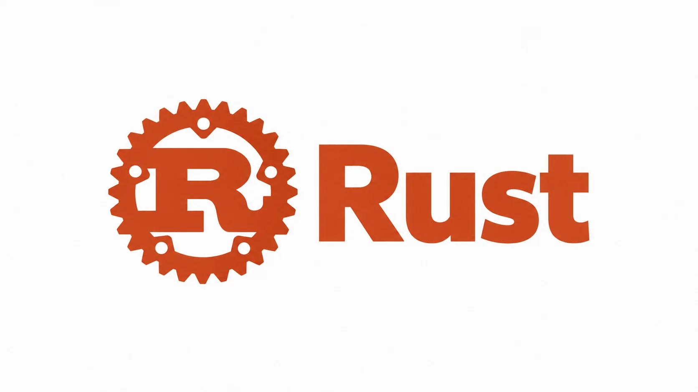

# Rust

本教程按《[The Rust Programming Language](https://doc.rust-lang.org/book/)》的 21 章结构编排，以中文重新讲解语言概念、代码示例和循序渐进的项目。章节顺序、主要主题与练习路径对应官方 Book；不是原书逐段翻译。

每章正文进一步按官方 Book 的小节主题展开；小节不另建文件，而是在对应章页内分节讲解。教程范围覆盖正文 21 章，官方附录作为独立参考资料可从 Rust Book 原文查阅。

教程面向有基本编程经验的读者。示例以 Rust 2024 Edition 为准，官方 Book 当前说明使用 Rust 1.97.0 或更新版本。安装方式和具体命令以官方文档为准。

## 章节

### 入门

1. [入门：安装、Hello World 与 Cargo](chapter-01-getting-started.md)
2. [编写猜数字游戏](chapter-02-guessing-game.md)
3. [常见编程概念](chapter-03-common-concepts.md)

### 所有权与类型建模

4. [理解所有权](chapter-04-understanding-ownership.md)
5. [使用结构体组织相关数据](chapter-05-structs.md)
6. [枚举与模式匹配](chapter-06-enums.md)
7. [使用包、crate 与模块管理项目](chapter-07-packages-crates-modules.md)
8. [常见集合](chapter-08-common-collections.md)
9. [错误处理](chapter-09-error-handling.md)
10. [泛型、Trait 与生命周期](chapter-10-generics-traits-lifetimes.md)
11. [编写自动化测试](chapter-11-writing-tests.md)

### 项目与进阶特性

12. [构建命令行 I/O 项目](chapter-12-io-project.md)
13. [迭代器与闭包](chapter-13-iterators-closures.md)
14. [更多 Cargo 与 crates.io](chapter-14-cargo-and-crates-io.md)
15. [智能指针](chapter-15-smart-pointers.md)
16. [无畏并发](chapter-16-concurrency.md)
17. [异步编程基础](chapter-17-async-await.md)
18. [面向对象编程特性](chapter-18-oop.md)
19. [模式与匹配](chapter-19-patterns.md)
20. [高级特性](chapter-20-advanced-features.md)
21. [项目：构建多线程 Web 服务器](chapter-21-web-server.md)

## 学习建议

按顺序学习前 11 章，建立 Rust 的语法、所有权和类型系统基础。第 12 章将这些概念组合成命令行程序；第 13–20 章依次扩展语言抽象、工具链和并发能力；第 21 章用完整项目收尾。

每章均包含关键概念、可运行示例和练习。项目中的代码会在后续章节继续改进；建议在自己的 Cargo 项目中逐步实现，而不只阅读最终代码。

## 官方资料

- [The Rust Programming Language](https://doc.rust-lang.org/book/)：本教程的章节与概念主线。
- [Rust 安装指南](https://rust-lang.org/install/)：安装和更新 Rust 工具链。
- [Rust 标准库文档](https://doc.rust-lang.org/stable/std/)：查找标准库类型与函数。
- [Rust Reference](https://doc.rust-lang.org/stable/reference/)：查询更完整的语言规则。
