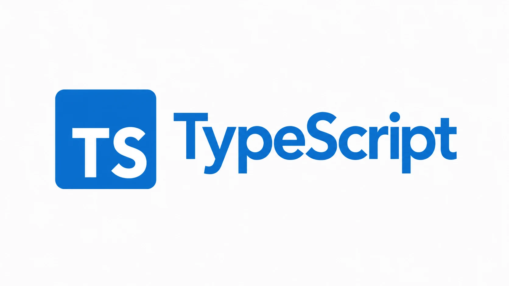

# TypeScript



本教程按 [TypeScript Handbook](https://www.typescriptlang.org/docs/handbook/intro.html) 的主线重新编排和讲解，覆盖基础、日常类型、类型收窄、函数、对象、从类型创建类型、类和模块。示例与解释为原创教学内容，不是官方文档的逐段翻译。

教程适合有 JavaScript 基础的读者。TypeScript 是 JavaScript 的静态类型检查器：类型检查发生在运行之前，类型注解通常会在编译时擦除，程序最终仍由 JavaScript 运行。若你尚未学习 JavaScript，建议先阅读[面向新手的 JavaScript 教程](https://developer.mozilla.org/zh-CN/docs/Learn_web_development/Core/Scripting)。

内容以 **TypeScript 6.0** 和现代 ECMAScript 模块项目为基线，最后核对日期：**2026-10-16**。TypeScript 6.0 是官方文档当前列出的版本；新项目使用显式 `tsconfig.json` 设置，避免依赖版本默认值变化。安装与版本信息见[官方安装页](https://www.typescriptlang.org/download/)和[6.0 发布说明](https://www.typescriptlang.org/docs/handbook/release-notes/typescript-6-0.html)。

## 学习路线

```text
环境与第一个程序 → 基础 → 日常类型 → 类型收窄 → 函数与对象
                                          ↓
                                   从类型创建类型
                                          ↓
                                   类与模块 → 小型项目
                                          ↓
                          配置、工具类型与官方参考资料
```

前六章构成日常 TypeScript 开发的核心路径。类和模块分别用于理解 JavaScript 类的类型表达及项目边界；项目实践把类型、校验和模块组合起来。读者已熟悉 JavaScript 时可以快速浏览第 1 章；初学类型系统时建议按顺序完成全部章节。

## 环境准备与第一个程序

需要 Node.js 和 npm。新建目录后在项目根目录执行：

```shell
mkdir ts-handbook-practice
cd ts-handbook-practice
npm init -y
npm install --save-dev typescript@6.0
npx tsc --init
```

将 `tsconfig.json` 中相关选项整理为下面的最小配置：

```json
{
  "compilerOptions": {
    "target": "ES2022",
    "module": "NodeNext",
    "moduleResolution": "NodeNext",
    "rootDir": "src",
    "outDir": "dist",
    "strict": true,
    "noEmitOnError": true
  },
  "include": ["src/**/*.ts"]
}
```

在 `package.json` 添加 `"type": "module"`，再创建 `src/index.ts`：

```ts
const learner = { name: "小林", completed: 3 };

function greeting(name: string, lessons: number): string {
  return `你好，${name}！已完成 ${lessons} 节。`;
}

console.log(greeting(learner.name, learner.completed));
```

编译并运行：

```shell
npx tsc
node dist/index.js
```

预期输出：

```text
你好，小林！已完成 3 节。
```

如果把 `completed` 改为字符串，严格检查会在编译阶段报告参数类型不匹配。`tsc` 只负责检查和生成 JavaScript；Node.js 才负责运行输出。

## Handbook 章节

以下章节对应官方 Handbook 主线；每一页会按概念依赖拆分小节，保留其主要主题和教学顺序。

1. [基础：理解 TypeScript 如何检查 JavaScript](basics.md)：类型检查器、编译流程、严格检查与项目配置。
2. [日常类型](everyday-types.md)：原始类型、数组、对象、联合类型、字面量、类型断言、空值与 `any`。
3. [类型收窄](narrowing.md)：控制流分析、类型守卫、判别联合和穷尽检查。
4. [深入函数](functions.md)：函数类型、可选与剩余参数、泛型、重载、`this` 和回调。
5. [对象类型](objects.md)：属性修饰符、索引签名、扩展、交叉类型、元组与只读数组。
6. [从类型创建类型](type-manipulation.md)：泛型、`keyof`、`typeof`、索引访问、条件、映射和模板字面量类型。
7. [类](classes.md)：字段、构造器、继承、可见性、抽象类、静态成员和 `implements`。
8. [模块](modules.md)：ES 模块语法、类型导入、模块解析、包边界和声明扩展概览。

## 配套参考范围

官方 Handbook 首页把 Utility Types、Enums、Decorators、Declaration Merging、Type Compatibility、Type Inference 等放在 **Reference**；TSConfig、声明文件、JavaScript 项目迁移和构建工具则分属配置、Declaration Files、JavaScript 与 Tutorials 等文档区。它们不是 Handbook 主线的额外章节，因此本教程在对应章节介绍常用入口，并提供官方链接供按需查阅。

## 学完后可以做什么

- 为函数参数、返回值和对象边界建立清晰的类型契约。
- 通过控制流缩小联合类型，并写出可穷尽检查的分支。
- 使用泛型和类型运算符复用类型关系，而不是重复维护相似声明。
- 配置严格检查、组织模块，并理解类型检查与运行时验证的边界。

TypeScript 类型不会验证来自网络、文件或用户输入的数据。实际项目仍应在运行时解析和校验外部输入；本教程项目章会用小型任务清单示范这条边界。

## 官方资料

- [TypeScript Handbook](https://www.typescriptlang.org/docs/handbook/intro.html)：本教程的核心概念与章节主线。
- [TypeScript 下载与安装](https://www.typescriptlang.org/download/)：通过 npm 安装并查看支持的安装方式。
- [TypeScript 6.0 发布说明](https://www.typescriptlang.org/docs/handbook/release-notes/typescript-6-0.html)：迁移、默认值和弃用项。
- [TSConfig Reference](https://www.typescriptlang.org/tsconfig/)：查询每个编译器选项。
- [Utility Types](https://www.typescriptlang.org/docs/handbook/utility-types.html)：查阅内置类型变换工具。
